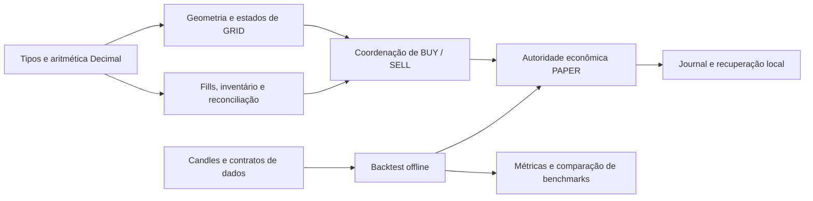

# GridBot · Bitcoin Spot Research

Pesquisa em Python sobre contabilidade de carteiras, simulação de GRID Spot,
backtesting e limites de risco. **Offline/PAPER: sem operação real.**

**English summary.** An offline Python engineering and quantitative research
project covering Bitcoin spot simulations, exact accounting, historical
backtesting and risk analysis. The active strategies examined did not establish
a robust advantage over simple benchmarks. This is not a production trading bot.

## Visão geral e motivação

O projeto investiga uma pergunta prática: negociar oscilações pode melhorar
patrimônio e quantidade física de BTC em comparação com alternativas simples,
depois de custos e risco? O desenvolvimento prioriza estados verificáveis,
conservação de ativos e evidências que possam contrariar a hipótese inicial.

Esta versão é um **snapshot público curado** de um projeto desenvolvido localmente.
Seu histórico começa na preparação desta versão; não representa a data de início
do desenvolvimento original. Os 104 módulos do núcleo correspondem aos blobs Git originais, com finais de linha LF.
Dados brutos e relatórios internos completos não fazem parte deste pacote.

## Tecnologias e arquitetura

Python 3.13, Decimal, Fraction para verificações racionais, dataclasses imutáveis,
Pydantic, pytest, Hypothesis, Ruff, Mypy, pre-commit e Gitleaks.



Mais detalhes: [ARCHITECTURE.md](ARCHITECTURE.md).

## O que está implementado

- Geometria aritmética em ticks inteiros e sizing quantizado explicitamente.
- Intenções BUY/SELL, identidade de ciclos e reservas exclusivas de capital/BTC.
- Ledgers de fills, reconciliação e liquidação econômica exclusivamente PAPER.
- Contabilidade por ativo, deduplicação, limites de inventário e conservação.
- Journal local, integridade, recuperação e simulação transitória.
- Backtest nativo com hipóteses explícitas de execução e benchmark.
- Experimentos nativos com recentralização e duas gerações preservando inventário.
- Testes unitários, adversariais, de propriedades e isolamento de arquitetura.

Código de tradução offline no namespace Binance não é integração de execução.
O CLI legado oferece diagnóstico; não inicia trading. LIVE é bloqueado.

## Metodologia e políticas estudadas

O desenvolvimento original estudou GRID estático, protótipo persistente,
recentralização, políticas passivas, DCA, bandas e acumulação de BTC.
As campanhas compararam políticas e benchmarks na mesma janela, com capital
hipotético equivalente, custos explícitos e distinção entre BTC físico e NAV.
Não se somam janelas sobrepostas como se fossem uma conta contínua.

O backtest não conhece a trajetória intrabar completa apenas por possuir OHLC.
Latência, participação no volume, fees e marcação são hipóteses do modelo,
não prova de execução que teria ocorrido na exchange.

## Contabilidade e conservação

BTC CORE é separado do inventário operacional: **GRID CANNOT SELL CORE BTC**.
Quantidades e valores financeiros usam Decimal; arredondamentos ao tick/step
são explícitos. Reservas são subconjuntos de fundos, não patrimônio adicional.

```text
NAV = USDT líquido + BTC físico líquido × preço de marcação
BTC equivalente = NAV / preço de marcação
```

BTC equivalente mede poder de compra; não significa moedas adicionais em custódia.
Fees são contabilizadas por ativo. Duplicatas e eventos inconsistentes não devem
gerar segunda liquidação ou gasto além do capital disponível.

## Resultados econômicos e risco

**Nenhuma estratégia ativa examinada demonstrou vantagem robusta conjunta sobre
os benchmarks simples.** Houve compromissos locais entre risco, patrimônio,
quantidade de BTC e custo de oportunidade.

Na campanha multidatas, nenhuma política com BTC respeitou uma tolerância
indicativa de drawdown de 20% em todas as janelas avaliadas. Manter caixa
preservou seu valor nominal no modelo, com zero crescimento e zero BTC físico.
Drawdown diário observado não é garantia sobre perdas intradiárias ou futuras.

O experimento prospectivo tem regras congeladas; não constitui evidência de
rentabilidade. A coleta não foi iniciada. O contrato original permite aquisição
manual apenas de 01/06/2027 até 08/06/2027, fim exclusivo, após autorização.

Leia [RESEARCH.md](RESEARCH.md) para a síntese, proveniência e limites. Esta
versão não inclui os corpus, runners das campanhas R1/M1 nem manifestos privados
necessários para reproduzir integralmente todas as pesquisas históricas.

## Instalação e uso offline

As dependências devem ser obtidas antes de trabalhar sem internet. Nenhum comando
abaixo baixa dados de mercado ou requer credenciais.

```powershell
py -3.13 -m venv .venv
.\.venv\Scripts\Activate.ps1
python -m pip install -c constraints.txt pydantic==2.13.5 pydantic-settings==2.15.0 python-dotenv==1.2.4 pytest==9.1.1 hypothesis==6.168.5 ruff==0.16.10 mypy==2.4.0
$env:PYTHONPATH = "src"
python -m examples.offline_grid
python -m pytest -q tests/domain/test_fees.py tests/strategy/test_arithmetic_grid.py
```

Em Linux/macOS: crie o venv com `python3.13 -m venv .venv`, ative com
`source .venv/bin/activate` e use `export PYTHONPATH=src` para os mesmos comandos.
As versões das dependências estão restringidas em `constraints.txt`; não se
promete instalação sem rede ou builds idênticos em toda plataforma.

O exemplo usa **preços sintéticos 90–110** e imprime os níveis exatos de uma
grade de quatro intervalos, zero ordens e zero requests. Não calcula retorno.

## Testes e estado de qualidade

`ci/smoke-suite.txt` lista uma seleção representativa de 930 casos. Ela cobre tipos, regras,
geometria, fills, reservas, PAPER, backtest sintético, journal e arquitetura.
Não substitui a suíte inteira nem o gate global de cobertura.

Há uma **pendência histórica de duração excessiva da suíte geral com cobertura**,
ainda não resolvida. Não há badge de CI/cobertura ou afirmação de aprovação
global. Essa seleção também atingiu 120 segundos localmente sem concluir:
**seu estado é PENDING, não PASS**. Não foram retirados casos para fazê-la passar.
`ci/github-actions-proposal.yml` é uma proposta **inativa**, com permissões de
leitura e limite de duração. Nenhum workflow é distribuído como ativo.
A ativação depende de diagnóstico e validação próprios.

## Organização

| Área | Conteúdo |
| --- | --- |
| `src/gridbot` | 104 módulos do núcleo, PAPER, backtest, configuração e infraestrutura |
| `tests` | Testes e fixtures selecionados do projeto original |
| `examples` | Demonstração offline de geometria com entradas sintéticas |
| `ci` | Lista explícita dos testes representativos |
| `docs/PUBLIC_SOURCE_MANIFEST.json` | Identidade e proveniência do snapshot |

Não são incluídos datasets, ZIPs, bancos, logs de contas, arquivos de autorização,
prompts, caminhos pessoais ou relatórios internos completos.

## Estado atual e próximos passos

Projeto experimental de engenharia e pesquisa, **não pronto para dinheiro real**.
O [ROADMAP.md](ROADMAP.md) prioriza documentação e qualidade; não autoriza
novas estratégias, otimização retrospectiva, Testnet ou LIVE.

## Segurança, autoria e licença

Não configure chaves de exchange ou carteiras. Veja [SECURITY.md](SECURITY.md).
Contribuições técnicas: [CONTRIBUTING.md](CONTRIBUTING.md).

Projeto conduzido por **Leonardo Siqueira Ribeiro dos Santos / SiqueiraBr15**,
com assistência de IA na implementação, preparação de testes, documentação e
revisões. O uso de assistentes não constitui auditoria externa certificada.

A licença de distribuição **ainda depende de decisão explícita do titular**.
Não foi adicionado arquivo LICENSE nem se presume uma licença open source.
As dependências mantêm suas próprias licenças; seus fontes não são vendorizados.
