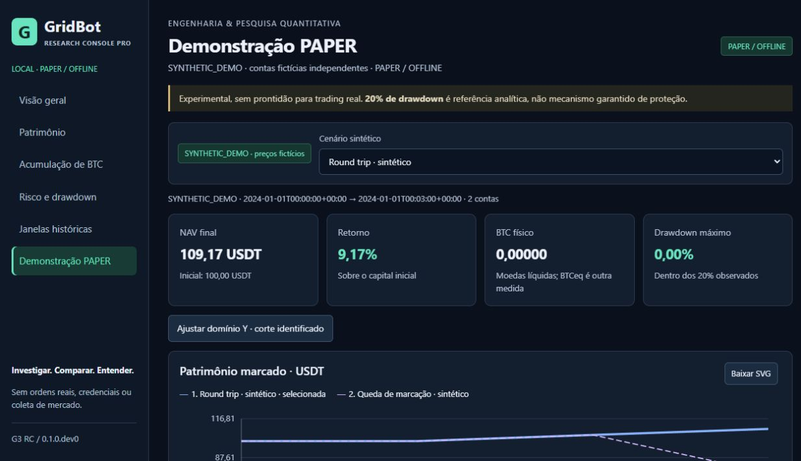
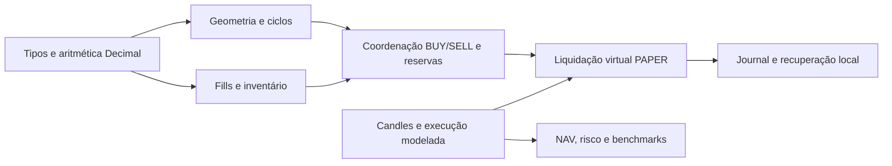

# GridBot · Bitcoin Spot Research

Um projeto Python de engenharia e pesquisa quantitativa: contabilidade exata,
reservas de ativos, simulação de GRID Spot e análise de risco.
**Demonstração offline/PAPER, sem operações reais.**

**English.** Exact asset accounting and reproducible Bitcoin spot simulations in
Python. The active strategies studied did not demonstrate a robust advantage
over simple benchmarks. This is an engineering/research portfolio, not a live
trading system.

## Console local de pesquisa

Após a instalação abaixo, execute `python -m research_console` no checkout e abra
**http://127.0.0.1:8765**. No Windows, `start_console.cmd` usa o ambiente `.venv`.
O console inclui patrimônio, BTC, drawdown, janelas e a demo PAPER determinística.
G2 acrescenta seleção persistente na sessão, referência comparativa, diferenças
exatas em USDT/pp/BTC, consulta por teclado e downloads CSV/JSON/SVG.
Os eixos identificam unidades e cortes; o drawdown tem zero no topo.
Histórico depende de origem local explicitamente autorizada; sem ela, mostra
**dados indisponíveis**. Nenhum dataset interno é distribuído ou copiado automaticamente.
[Instalação, uso, segurança e métricas](docs/RESEARCH_CONSOLE.md).
G1–G3.2 foram integradas à main; CI remoto continua desativado.
[Auditoria G3.1 e limites da validação](docs/reviews/G3_1_GLOBAL_QUALITY_GATE_CLOSURE_AUDIT.md).
[Integração e prontidão de publicação G3.2](docs/reviews/G3_2_RELEASE_INTEGRATION_AND_PUBLICATION_AUDIT.md).
O console inclui navegação voltar/avançar, timeout/cancelamento,
marcas exatas acessíveis, metadados de export e isolamento de portas/sessões.

A candidata **G4 Offline Research Lab**, endurecida na branch local
`release/g4-offline-research-lab`, acrescenta biblioteca, Evidence Packs com SHA-256,
importação com confirmação, análise exata, comparação Pareto, episódios de risco,
trilha PAPER e replay de análises. Sem novo backtest ou execução financeira.
[Guia G4 e exemplos](docs/G4_RESEARCH_LAB.md) ·
[Schema Evidence Pack v1](docs/G4_EVIDENCE_PACK_V1.md).
G4 ainda não foi publicada; históricos privados não fazem parte dos exemplos.
G4.1 valida o fluxo ZIP efetivo, serializa gravações concorrentes e exige
autorização de exportação independente dos metadados de pacotes externos.
[Auditoria e limites G4.1](docs/reviews/G4_1_RESEARCH_LAB_HARDENING_AND_GLOBAL_QUALITY_AUDIT.md).



## O que você encontra aqui

- Geometria em ticks inteiros, sizing quantizado e valores financeiros em Decimal.
- Coordenação BUY/SELL, inventário, reservas, deduplicação e reconciliação.
- Liquidação virtual PAPER, journal local e recuperação verificável.
- Backtest com custos, latência e ambiguidade intrabar explícitos.
- Testes adversariais, propriedades Hypothesis e restrições de arquitetura.
- Uma demonstração sintética com fills, NAV, replay e oráculo racional independente.

Python 3.13 · Decimal/Fraction · dataclasses · Pydantic · pytest/Hypothesis · Ruff/Mypy.
Os 104 módulos nativos preservam os blobs do projeto original. O histórico deste
snapshot começa na curadoria pública, sem simular o histórico de desenvolvimento.

## Execute uma demonstração segura

A instalação requer acesso ao PyPI; depois, a demonstração usa apenas dados
sintéticos em memória. Não requer chaves, contas ou dados de mercado.

```powershell
git clone https://github.com/SiqueiraBr15/bitcoin-gridbot-research.git
cd bitcoin-gridbot-research
py -3.13 -m venv .venv
.\.venv\Scripts\python.exe -m pip install pip==26.2.1
.\.venv\Scripts\python.exe -m pip install -c constraints.txt --build-constraint build-constraints.txt -e ".[dev]"
.\start_console.cmd
```

O console G1–G3.2 está na main. Para revisar G4, use sua candidata local;
não existe release G4 publicada.
Os comandos de clone acima obtêm a main disponível hoje. A branch candidata G4
continua local até autorização de publicação. No checkout que já contém a
candidata, selecione `git switch release/g4-offline-research-lab` antes de instalar.
Após uma publicação autorizada dessa branch, será possível clonar com
`git clone --branch release/g4-offline-research-lab https://github.com/SiqueiraBr15/bitcoin-gridbot-research.git`.
Esse último comando depende da existência futura da branch remota; não é uma
instrução para publicar ou uma afirmação de que ela já está disponível.
Abra `http://127.0.0.1:8765`, escolha **Demonstração PAPER** e clique em
**Executar cenários sintéticos**. CSV/JSON exportam essa seleção; os gráficos
oferecem SVG. Ctrl+C no terminal encerra o processo. Não há início automático.
O exemplo JSON sem navegador é `.\.venv\Scripts\python.exe -m examples.paper_cycle`.

Em Linux/macOS: `python3.13 -m venv .venv` e `source .venv/bin/activate`,
seguindo os mesmos comandos `python`. Essa plataforma ainda não foi executada
nesta validação local. Os exemplos são executados a partir do checkout.

O JSON mostra duas contas independentes, com três candles fictícios cada:
intenções/fills, fees em USDT, caixa disponível/reservado, BTC físico e NAV.
Inclui uma trajetória de perda. O oráculo em Fraction reconstrói os saldos a partir
dos fills e verifica todas as marcações; o replay nativo reproduz o estado final.
**Não são preços históricos nem evidência de retorno de uma estratégia.**
Veja [o exemplo explicado](examples/README.md). A geometria isolada continua em
`python -m examples.offline_grid`.

## Arquitetura e invariantes



BTC CORE é separado do inventário operacional: **GRID CANNOT SELL CORE BTC**.
Reservas são subconjuntos de fundos, nunca patrimônio adicional.

```text
NAV = USDT líquido + BTC físico líquido × preço de marcação
BTC equivalente = NAV / preço de marcação
```

BTC equivalente mede poder de compra; não são moedas adicionais em custódia.
A demonstração usa fees em USDT. Os contratos e testes nativos também tratam
fees por ativo. O CLI oferece diagnóstico; não inicia trading e bloqueia LIVE.
Mais detalhes em [ARCHITECTURE.md](ARCHITECTURE.md).

## Evidências de engenharia

A candidata local **G4.1** tem uma campanha nova em Windows/Python 3.13.16:
**3.610 Python PASS + dois skips preexistentes**, 3.612 nodeids únicos,
273 segmentos e zero incompletos. A cobertura consolidada de **104 módulos
nativos + 16 do console** é **96,48%**, com linhas e branches e threshold 85%.
Os três módulos empacotados de exemplos têm medição suplementar separada de
**87,37%**; não se faz média dos percentuais. Os **26 testes JavaScript** são
contabilizados separadamente. [Relatório G4.1](docs/reviews/G4_1_RESEARCH_LAB_HARDENING_AND_GLOBAL_QUALITY_AUDIT.md)
e [manifesto da execução](docs/reviews/G4_1_EXECUTION_MANIFEST.json.gz).
Esses resultados locais não equivalem a CI remoto, teste Linux/macOS ou
prontidão para trading. As evidências G3.1 abaixo permanecem históricas.

Evidência local G3.1 em Windows/Python 3.13.16, com dependências fixadas,
inventário completo e união auditada de execuções segmentadas:

| Verificação | Resultado e alcance |
| --- | --- |
| Testes Python | **3.420 PASS + dois skips preexistentes**, 3.422 nodeids, zero pendentes |
| JavaScript | **19 PASS**, separados de pytest |
| Cobertura nativa | **96,53%**; source `gridbot`, linhas + branches, threshold **85%**, exit 0 |
| Console Python | Cobertura dirigida própria, separada da nativa; consultar auditorias |
| Ruff e Mypy | Verificações locais aprovadas, incluindo exemplos e ferramentas |
| Demonstração | Conservação racional, replay, determinismo e bloqueio de rede testado |

As contagens anteriores e tentativas com timeout permanecem nos relatórios.
O número de cobertura identifica os 104 módulos nativos, não toda a árvore do
checkout. A interface o apresenta como evidência arquivada, sem badge de CI.

```text
python -m tools.verify --profile smoke
python -m tools.verify --profile unit
python -m tools.verify --profile integration
python -m tools.verify --profile extended
python -m tools.test_catalog
python -m ruff check .
python -m ruff format --check .
python -m mypy
```

O runner usa limites finitos por alvo; falha/timeout retorna código não zero.
Nenhum teste foi desabilitado e o perfil Hypothesis CI permanece com 300 exemplos.
O fechamento local G3.1 contabilizou **3.420 Python PASS + dois skips** e
**19 JavaScript PASS**, sem pendentes. A cobertura nativa consolidada foi
**96,53%**, com branches e threshold original de 85%, exit 0. O inventário e a
união segmentada foram verificados por nodeids e hashes; os timeouts anteriores
permanecem registrados. Isso não demonstra execução Linux/CI remoto nem todas
as ordens monolíticas. Leia [TESTING_AND_PERFORMANCE.md](TESTING_AND_PERFORMANCE.md)
e a [auditoria G3.1](docs/reviews/G3_1_GLOBAL_QUALITY_GATE_CLOSURE_AUDIT.md).

A [proposta de CI](ci/github-actions-proposal.yml) é inativa, fora de
`.github/workflows`. Não há execução remota aprovada ou badges de CI/cobertura.

## Pesquisa: o que foi aprendido

GRID tradicional, GRID persistente e rebalanceamento por bandas **não demonstraram
vantagem robusta suficiente** sobre benchmarks simples nas campanhas examinadas. Houve resultados locais positivos e negativos e compromissos
entre patrimônio, BTC físico, risco e custos. Nenhuma política com BTC respeitou
uma tolerância indicativa de drawdown de 20% em todas as janelas avaliadas.
Caixa preservou valor nominal no modelo, sem crescimento ou acumulação de BTC.

Datas de entrada e janelas sobrepostas limitam a inferência estatística. OHLC não
revela toda a trajetória intrabar; execução, fees e slippage são hipóteses.
A análise diária não garante limite de perdas futuro ou intradiário.
[RESEARCH.md](RESEARCH.md) documenta a síntese e suas limitações. Os corpus e
runners internos das campanhas R1/M1 não são redistribuídos; a reprodução pública
integral desses resultados não é afirmada. O protocolo prospectivo permanece
congelado e sua coleta depende de autorização separada.

## Limites e continuidade

Este snapshot é experimental e **não está pronto para dinheiro real**. Não inclui
adaptador ativo de ordens, credenciais ou datasets pessoais. Há um coletor opt-in
de arquivos públicos oficiais no núcleo preservado; ele não foi executado nesta
missão e não participa das demonstrações. Nenhuma coleta prospectiva foi autorizada.
O wheel G3 distribui `gridbot`, `research_console` e os exemplos sintéticos,
incluindo os assets locais. Testes e ferramentas de auditoria ficam no checkout.
Após instalar/ativar o ambiente, `gridbot-research-console` funciona fora do clone.
As versões fixadas restringem dependências, sem prometer builds binariamente
idênticos em toda plataforma ou disponibilidade permanente do PyPI.

O [roadmap](ROADMAP.md) prioriza testes, documentação e revisão dos gargalos,
sem reabrir otimização retrospectiva das políticas congeladas.
[Contribuição](CONTRIBUTING.md) · [Segurança](SECURITY.md) ·
[Proveniência](docs/PUBLIC_SOURCE_MANIFEST.json).

Projeto conduzido por **Leonardo Siqueira Ribeiro dos Santos / SiqueiraBr15**,
com assistência de IA em implementação, testes, documentação e revisão.
Essa assistência não constitui auditoria externa certificada.

Licenciado sob a [MIT](LICENSE). Copyright © 2026 Leonardo Siqueira Ribeiro dos Santos.
As dependências preservam suas próprias licenças; seus fontes não são vendorizados.
Veja [THIRD_PARTY_NOTICES.md](THIRD_PARTY_NOTICES.md) para o escopo e atribuições.
