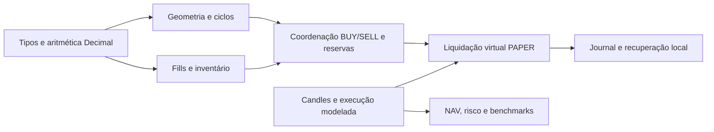

# GridBot · Bitcoin Spot Research

Um projeto Python de engenharia e pesquisa quantitativa: contabilidade exata,
reservas de ativos, simulação de GRID Spot e análise de risco.
**Demonstração offline/PAPER, sem operações reais.**

**English.** Exact asset accounting and reproducible Bitcoin spot simulations in
Python. The active strategies studied did not demonstrate a robust advantage
over simple benchmarks. This is an engineering/research portfolio, not a live
trading system.

## O que você encontra aqui

- Geometria em ticks inteiros, sizing quantizado e valores financeiros em Decimal.
- Coordenação BUY/SELL, inventário, reservas, deduplicação e reconciliação.
- Liquidação virtual PAPER, journal local e recuperação verificável.
- Backtest com custos, latência e ambiguidade intrabar explícitos.
- Testes adversariais, propriedades Hypothesis e restrições de arquitetura.
- Uma demonstração sintética com fills, NAV, replay e oráculo racional independente.

Python 3.13 · Decimal/Fraction · dataclasses · Pydantic · pytest/Hypothesis · Ruff/Mypy.
Os 104 módulos nativos preservam os blobs do projeto original. O histórico deste
snapshot começa na curadoria pública, sem simular o histórico de desenvolvimento.

## Execute uma demonstração segura

A instalação requer acesso ao PyPI; depois, a demonstração usa apenas dados
sintéticos em memória. Não requer chaves, contas ou dados de mercado.

```powershell
py -3.13 -m venv .venv
.\.venv\Scripts\Activate.ps1
python -m pip install pip==26.2.1
python -m pip install -c constraints.txt --build-constraint build-constraints.txt -e ".[dev]"
python -m examples.paper_cycle
```

Em Linux/macOS: `python3.13 -m venv .venv` e `source .venv/bin/activate`,
seguindo os mesmos comandos `python`. Essa plataforma ainda não foi executada
nesta validação local. Os exemplos são executados a partir do checkout.

O JSON mostra duas contas independentes, com três candles fictícios cada:
intenções/fills, fees em USDT, caixa disponível/reservado, BTC físico e NAV.
Inclui uma trajetória de perda. O oráculo em Fraction reconstrói os saldos a partir
dos fills e verifica todas as marcações; o replay nativo reproduz o estado final.
**Não são preços históricos nem evidência de retorno de uma estratégia.**
Veja [o exemplo explicado](examples/README.md). A geometria isolada continua em
`python -m examples.offline_grid`.

## Arquitetura e invariantes



BTC CORE é separado do inventário operacional: **GRID CANNOT SELL CORE BTC**.
Reservas são subconjuntos de fundos, nunca patrimônio adicional.

```text
NAV = USDT líquido + BTC físico líquido × preço de marcação
BTC equivalente = NAV / preço de marcação
```

BTC equivalente mede poder de compra; não são moedas adicionais em custódia.
A demonstração usa fees em USDT. Os contratos e testes nativos também tratam
fees por ativo. O CLI oferece diagnóstico; não inicia trading e bloqueia LIVE.
Mais detalhes em [ARCHITECTURE.md](ARCHITECTURE.md).

## Evidências de engenharia

Validação local Windows/Python 3.13, em ambiente novo, com dependências fixadas:

| Verificação | Resultado e alcance |
| --- | --- |
| Instalação | Editable e wheel; import/CLI do wheel fora do checkout |
| Testes | 1.623 casos distintos aprovados em segmentos, incluindo 5 novos; 1 skip Windows |
| Seleção anterior | Todos os 930 casos cobertos pelos segmentos concluídos |
| Coleta completa | 3.277 casos coletados; não significa 3.277 executados |
| Ruff e Mypy | Verificações locais aprovadas, incluindo exemplos e ferramentas |
| Demonstração | Conservação racional, replay, determinismo e bloqueio de rede testado |

```text
python -m tools.verify --profile smoke
python -m tools.verify --profile unit
python -m tools.verify --profile integration
python -m tools.verify --profile extended
python -m tools.test_catalog
python -m ruff check .
python -m ruff format --check .
python -m mypy
```

O runner usa limites finitos por alvo; falha/timeout retorna código não zero.
Nenhum teste foi desabilitado e o perfil Hypothesis CI permanece com 300 exemplos.
O gate global de cobertura continua **PENDING**. O timeout monolítico anterior
permanece registrado; completar segmentos não aprova a suíte global com cobertura.
Leia [TESTING_AND_PERFORMANCE.md](TESTING_AND_PERFORMANCE.md).

A [proposta de CI](ci/github-actions-proposal.yml) é inativa, fora de
`.github/workflows`. Não há execução remota aprovada ou badges de CI/cobertura.

## Pesquisa: o que foi aprendido

GRID tradicional, GRID persistente e rebalanceamento por bandas **não demonstraram
vantagem robusta suficiente** sobre benchmarks simples nas campanhas examinadas. Houve resultados locais positivos e negativos e compromissos
entre patrimônio, BTC físico, risco e custos. Nenhuma política com BTC respeitou
uma tolerância indicativa de drawdown de 20% em todas as janelas avaliadas.
Caixa preservou valor nominal no modelo, sem crescimento ou acumulação de BTC.

Datas de entrada e janelas sobrepostas limitam a inferência estatística. OHLC não
revela toda a trajetória intrabar; execução, fees e slippage são hipóteses.
A análise diária não garante limite de perdas futuro ou intradiário.
[RESEARCH.md](RESEARCH.md) documenta a síntese e suas limitações. Os corpus e
runners internos das campanhas R1/M1 não são redistribuídos; a reprodução pública
integral desses resultados não é afirmada. O protocolo prospectivo permanece
congelado e sua coleta depende de autorização separada.

## Limites e continuidade

Este snapshot é experimental e **não está pronto para dinheiro real**. Não inclui
adaptador ativo de ordens, credenciais ou datasets pessoais. Há um coletor opt-in
de arquivos públicos oficiais no núcleo preservado; ele não foi executado nesta
missão e não participa das demonstrações. Nenhuma coleta prospectiva foi autorizada.
O wheel distribui o pacote `gridbot`; exemplos/testes/ferramentas ficam no checkout.
As versões fixadas restringem dependências, sem prometer builds binariamente
idênticos em toda plataforma ou disponibilidade permanente do PyPI.

O [roadmap](ROADMAP.md) prioriza testes, documentação e revisão dos gargalos,
sem reabrir otimização retrospectiva das políticas congeladas.
[Contribuição](CONTRIBUTING.md) · [Segurança](SECURITY.md) ·
[Proveniência](docs/PUBLIC_SOURCE_MANIFEST.json).

Projeto conduzido por **Leonardo Siqueira Ribeiro dos Santos / SiqueiraBr15**,
com assistência de IA em implementação, testes, documentação e revisão.
Essa assistência não constitui auditoria externa certificada.

Licenciado sob a [MIT](LICENSE). Copyright © 2026 Leonardo Siqueira Ribeiro dos Santos.
As dependências preservam suas próprias licenças; seus fontes não são vendorizados.
Veja [THIRD_PARTY_NOTICES.md](THIRD_PARTY_NOTICES.md) para o escopo e atribuições.
