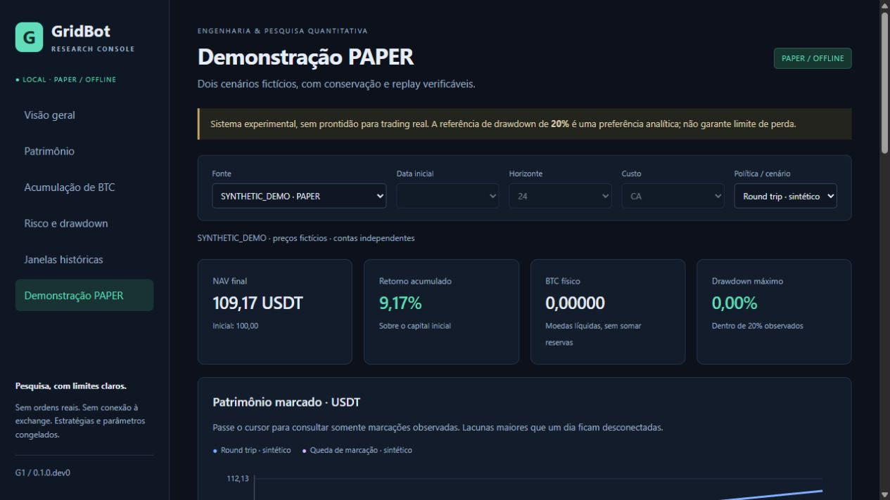
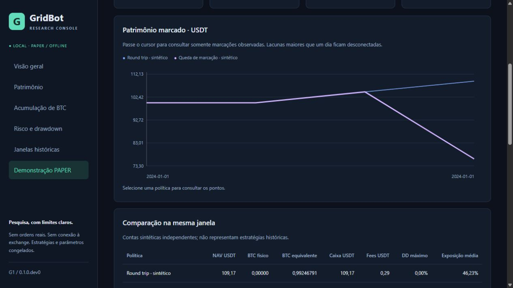

# G1 — Research Console: implementação e auditoria

Data do cliente: **2026-10-23 — America/Sao_Paulo**.

`G1_RESEARCH_CONSOLE_PASS`

Interface funcional, local e testada. O PASS é do escopo G1 delimitado abaixo;
não aprova trading, estratégias, qualidade global ou publicação automática.

## Baseline e base de desenvolvimento

| Repositório | Branch inicial | HEAD conferido |
| --- | --- | --- |
| Snapshot público | main | `a28e6f35b7b0acb42cee6dc97959cdf65f6022b0` |
| Original somente leitura | main | `528f8c40ce6f74f9440444b2e652c56fae222fb2` |

O snapshot público estava limpo e correspondia à última versão publicada.
O original tinha somente os seis históricos não rastreados já conhecidos,
nenhum diff rastreado e nenhum remote. A nova branch local é
**`feat/g1-research-console`**, criada sobre a versão pública, sem checkout ou
mudanças no original. O main local e o main remoto continuam no baseline a28e6f3.

Foram examinados arquitetura, pyproject/constraints, segurança, demo PAPER,
testes, relatórios M1/M1.R/M2/R1, matrizes/índices e contratos de séries.
Não havia framework de interface. A base pública é suficiente para a demo;
as curvas M1.R já existem e dispensam reconstruir decisões históricas.

## Arquitetura escolhida

Python stdlib HTTP em **127.0.0.1**, com assets HTML/CSS/JS locais e gráficos SVG
interativos. Sem novas dependências de runtime, framework web, frontend build,
CDN ou telemetria. Streamlit adicionaria uma cadeia de dependências e configuração
de servidor desnecessária para o recorte de consulta. Não se afirma aptidão deste
servidor de desenvolvimento para uso em produção ou exposição pública.

Responsabilidades separadas:

| Arquivo | Responsabilidade |
| --- | --- |
| `research_console/data.py` | Origem explícita, quotas, SHA-256, schemas e projeção dos campos admitidos |
| `research_console/risk.py` | Funções puras reutilizadas do método M1.R, sem decisões de estratégia |
| `research_console/demo.py` | Adaptação da demo existente; conserva Fraction/replay e contexto Decimal local |
| `research_console/server.py` | Rotas fixas, leitura, sessão efêmera, comparação pareada e export da mesma seleção |
| `research_console/__main__.py` | Inicialização manual, porta e autorização da origem local |
| `research_console/static/` | Navegação, indicadores, gráficos, seletores e download local |

O prefixo puro de `analysis/m1_risk/risk.py`, até antes de `dominated`, foi
reutilizado no snapshot público; todos os ASTs de funções/classes reutilizadas
coincidem com a origem, independentemente da formatação. Nenhuma lógica de sinal,
execução ou liquidação foi recriada no frontend. Os 104 módulos nativos e os
exemplos existentes continuam iguais ao baseline. O console requer o checkout;
não foi adicionado ao wheel financeiro nem à autoridade do CLI do núcleo.

## Funcionalidades concluídas

- Visão geral com modo PAPER/offline, versão G1, fonte, integridade, data do
  relatório, políticas e conclusões negativas/limitações da pesquisa.
- Seleção das entradas M1 arquivadas, horizontes 6/12/24 e custos CA/CX2/CB;
  datas inexistentes não são inventadas. Seleção de política atualiza indicadores.
- Patrimônio/retorno e comparação com benchmarks na mesma janela, capital e mark;
  diferenças de NAV e retorno calculadas em Fraction no backend.
- BTC físico, BTC equivalente e caixa, com definições separadas; reservas não
  criam patrimônio adicional. Explicação de `ΔNAV = mark × ΔBTC + Δcaixa`.
- DD assinado, magnitude máxima, pico/vale, recuperação e censura, maior episódio,
  tempo amostral abaixo do pico, exposição e frequências no horizonte/custo.
- Explorador das janelas com todos os benchmarks e fees. Aviso de retrospectividade
  e sobreposição, sem score, escolha automática de política ou composição de contas.
- Demonstração existente: duas contas sintéticas, ganho/perda, eventos, referências
  de ordens PAPER, fills, disponível/reservado separados, BTC, NAV e conservação.
- Export JSON local da janela selecionada, acionado explicitamente pelo usuário.
- Tratamento de `SYNTHETIC_DEMO`, `ARCHIVED_RESEARCH_RESULT` e `UNAVAILABLE`.
  Origem ausente/corrompida não vira histórico sintético ou seleção antiga silenciosa.
- Tema escuro, layout responsivo, controles acessíveis, cursor sobre marcas reais,
  legendas e curvas com lacunas maiores que um dia desconectadas.

A referência **20%** está visível como preferência analítica, não stop-loss ou
garantia. A fronteira usa a fração exata 1/5 antes de arredondar. Capital inicial,
empates de pico/vale, igualdade na recuperação e censura seguem M1.R/M2.
Os pontos não foram interpolados/resampleados. Number no navegador serve somente
para coordenadas/formatação; valores exatos e classificação vêm do backend.

## Dados e proveniência

O uso local dos resultados internos foi autorizado no prompt. A execução de
conferência recebeu explicitamente uma pasta de relatórios no argumento
`--archive-root`; o código público não contém esse caminho real como default.

O leitor admite somente o contrato M1.R cujo manifesto tem SHA-256
`405755ffd2c3de0abeab4751e59f428e0dd5c8f933c329d097842585df58b68d`.
São lidos manifesto, nove matrizes, índice e chunks das curvas selecionadas.
O catálogo de **4.266 linhas** foi carregado e suas identidades finais verificadas.
As demais curvas permanecem verificadas sob seleção, sem anúncio de scan integral
das 1.730.196 marcas ao iniciar.

**Nenhuma matriz, curva interna, candle bruto, ledger ou relatório interno foi
copiado para o snapshot público.** As imagens versionadas mostram somente a
demo sintética. R1/M2 fornecem contexto e definições; seus corpus não ganharam
importadores genéricos nesta fase. Ausência deles não autoriza novos backtests.
O pin é de proveniência do artefato, não prova de autenticidade externa do mercado.

## Reconciliação de métricas

Conferidas as duas entradas pedidas, **2020-01-02 e 2022-12-02**, nos três horizontes
e três custos: **18 seleções, 108 carteiras, 46.134 marcas**. Todos os campos
recalculados por `profile` coincidiram com a respectiva linha M1.R arquivada.
NAV, caixa, BTC físico, mark, endpoints e DD foram reconciliados sem novos fills
ou backtests. Essa amostra técnica não é nova evidência econômica independente.

Exemplo, **2022-12-02 → 2024-12-02, CA**, NAV exato:

| Política | NAV final USDT |
| --- | --- |
| Comprar e manter | 56960.3806304960000 |
| 50/50 passivo | 33573.1335698656000 |
| DCA | 28012.4688067201000 |
| Caixa | 10000.00000000 |
| Bandas | 26284.8049213078000 |
| Mensal | 25696.5583290822000 |

A demo existente conserva **100 USDT iniciais por conta** e termina com NAV
**109.17147000** no round_trip e **76.26013000** no falling_mark. Entradas
deliberadamente fictícias; não se afirma reprodução de retorno histórico.
O oráculo Fraction do exemplo reconstitui ativos/fills e verifica resíduo zero;
o replay PAPER nativo confere. Testes bloqueiam connect/create_connection/DNS
no caminho da demonstração e verificam isolamento do contexto Decimal.

## Qualidade e tentativas preservadas

| Verificação final | Resultado |
| --- | --- |
| Testes G1 | **56 PASS**, 51,88 s de pytest, limite de processo 120 s |
| Cobertura dirigida `research_console`, branches incluídos | **95,26%**, limiar 85% mantido |
| Regressão existente | **322 PASS**, 23,08 s, limite 120 s |
| Ruff / format | PASS em todo o checkout |
| Mypy strict | PASS, 258 arquivos |
| pip check | PASS; dependências de runtime inalteradas |
| JavaScript | `node --check` PASS; navegador executou os menus e filtros |
| Gitleaks staged / hooks | PASS, sem achados; relatórios redigidos e erros não omitidos |
| Pre-commit | PASS; checks não aplicáveis a documentos aparecem como skip, não como testes executados |

Cobertura por módulo dirigida: data ~99%, demo 100%, risk ~93%, server ~94%,
startup ~84%. Caminhos restantes incluem encerramento/interrupção de startup,
helper de quantil sem uso na UI, ramo de comparação incompatível e contingências
de I/O/logging. Não se elevaram números com alteração do limiar/exclusões.
Hypothesis CI continua em 300 exemplos. Os 56 casos incluem oráculo quadrático
de DD, limite exato, empates/censura, saldos/BTCeq, corrupção, hashes, caminhos,
quotas comprimidas, falta de dados, no-network, determinismo e HTTP real local.

Regressão: `tests/architecture`, `tests/backtest/test_metrics.py`,
`tests/test_repo_hygiene.py` e `tests/test_public_demo.py`. Nenhum teste antigo
foi desabilitado. O gate **global** com cobertura continua **PENDING**, sem
repetição indiscriminada da suíte monolítica ou afirmação de CI remoto aprovado.

Tentativas anteriores **não são PASS** e seus logs foram mantidos:

1. 45 PASS / 5 FAIL: auxiliar dos testes usava HTTPConnection como context manager;
   corrigido para `contextlib.closing`, sem mudança financeira.
2. 49 PASS / 1 FAIL: cliente HTTP de teste de 3 s expirou na demo instrumentada
   com cobertura; cliente passou a limite finito 15 s, suíte permaneceu em 120 s.
3. Uma seleção inicial de regressão terminou com exit 4 por caminho inexistente
   `tests/examples`; nenhum teste executou nessa tentativa. Corrigida para o
   arquivo realmente existente `tests/test_public_demo.py`, resultando em 322 PASS.
4. Lints/formatação iniciais foram corrigidos antes do resultado final.

Os recibos integrais ficam no audit privado da missão, fora do repositório
publicável. O [resumo sanitizado](g1/G1_VALIDATION_SUMMARY.json) acompanha esta
entrega; não contém paths privados, tokens ou datasets.

## Verificação visual e capturas

Verificação real no navegador: overview, patrimônio, BTC, risco, janelas,
demonstração, política, data, horizonte e custo, tooltip de marca observada,
ausência de origem e troca de volta para histórico indisponível. Conferidos
26.284,80 USDT / 14,03% de bandas na janela 2022/24m/CA e frequência 50/69.
O teste de seletor estrito de custo encontrou um locator inadequado e foi
repetido com o controle correto; a troca para CX2 foi efetivamente conferida.
Isso não foi apresentado como falha ou aprovação de um teste econômico.

Capturas reais, exclusivamente `SYNTHETIC_DEMO`:





A viewport do navegador nesta sessão foi aproximadamente 1264×712. CSS tem
breakpoints para telas menores/maiores, mas não se afirma ensaio separado em
monitor físico Full HD, mobile, Linux ou outro navegador.

## Segurança e preservação

HTTP ligado exclusivamente a 127.0.0.1, sem parâmetro de bind remoto. Rotas fixas,
sem upload, caminho fornecido pelo browser, execução arbitrária ou endpoint de
ordens. Host/Origin/Sec-Fetch-Site e sessão efêmera HttpOnly/SameSite=Strict
restringem uso cruzado; CSP sem terceiros/framing e respostas no-store.
Nomes, delimitação da origem, links/junctions, limites 512 KiB comprimido/8 MiB
descomprimido e hashes são verificados. Mensagens e logs não expõem paths da origem.
Não é sandbox contra administrador ou usuário local capaz de adulterar o processo.

Os **1.665 arquivos preexistentes do original** foram novamente conferidos por
SHA-256, sem diferenças. Os seis históricos continuam não rastreados. Não houve
mudança no HEAD/histórico, CORE, datasets, políticas ou parâmetros congelados.
V2 FINAL mantém SHA-256
`44e9639554d01c13e2e0648613e7904a6f1649ca934b00b3821021aa28582249`.
Nenhum acesso a documentos corporativos BIMSTRUCT ou varredura global do disco.
Não houve Binance privada, ordem real, credencial financeira, carteira conectada,
LIVE/Testnet ou coleta prospectiva. Não foi iniciado serviço permanente.

## Arquivos e uso

Criados: seis módulos Python do console, três assets estáticos, teste dirigido,
`start_console.cmd`, `docs/RESEARCH_CONSOLE.md`, `docs/G1_CHANGELOG_AND_PR.md`,
duas capturas, este relatório e `g1/G1_VALIDATION_SUMMARY.json`.
Modificados somente `README.md` e `pyproject.toml` (inclusão do console no Mypy).
O requisito de runtime/dependências do pacote não mudou.

Instruções completas em [RESEARCH_CONSOLE.md](../RESEARCH_CONSOLE.md).
Após instalar o ambiente conforme README:

```powershell
.\.venv\Scripts\python.exe -m research_console
```

Abra http://127.0.0.1:8765. No Windows também existe `start_console.cmd`.
Histórico é opcional via `--archive-root` absoluto autorizado; sem ele a demo
continua funcional. Ctrl+C encerra uma inicialização manual no terminal.
A instalação requer PyPI; a aplicação não precisa de rede externa para funcionar.
Validação desta sessão usou o ambiente isolado de desenvolvimento já instalado.
Prettier 3.6.2 foi ferramenta temporária de formatação dos assets, em cache privado;
Node/npm/Prettier não são dependências de instalação ou execução do console.

## Commits, publicação e limites

Implementação: **`cdd4d1f3d519705972c82b6304c1a9572db7a0b1`**,
`Add local offline research console with verified archive views`.
Este relatório/resumo têm commit documental separado, cujo HEAD final é informado
na entrega para evitar autorreferência. Branch pronta para revisão local, sem PR
remoto criado. A [descrição de PR](../G1_CHANGELOG_AND_PR.md) foi preparada.

Leitura final de main remoto: **a28e6f35b7b0acb42cee6dc97959cdf65f6022b0**.
Actions continua `enabled: false`. Nenhum push, remote novo, force-push ou mudança
de perfil GitHub nesta fase.

Limites/próximas melhorias, sem implementação automática: importer de outras
campanhas só com contrato/proveniência definidos; automação de testes visuais
mobile/Full HD; validação em Linux; diagnóstico global de cobertura em fase própria.
O export HTTP foi validado com cliente local; não se afirma teste automatizado
de todos os diálogos de download possíveis de navegadores.
Não foram medidos limites de concorrência ou escalabilidade de servidor; não
foi acrescentada capacidade de trading ou pesquisa econômica.

`ORIGINAL_GRIDBOT_PRESERVED`

`FROZEN_V2_PRESERVED`

`REAL_TRADING_DISABLED`

`GITHUB_PUSH_NOT_PERFORMED`

**PARADO para revisão do usuário e do ChatGPT orquestrador. Nenhuma próxima fase
ou publicação desta funcionalidade foi iniciada automaticamente.**
