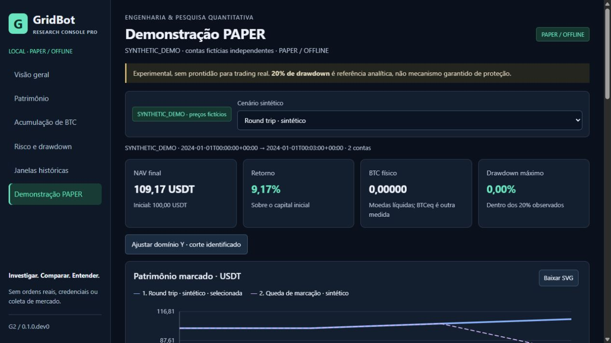
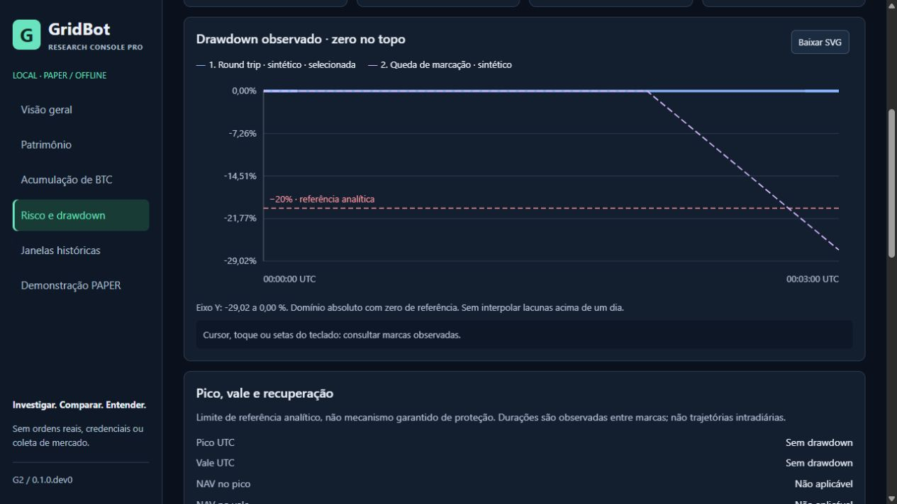
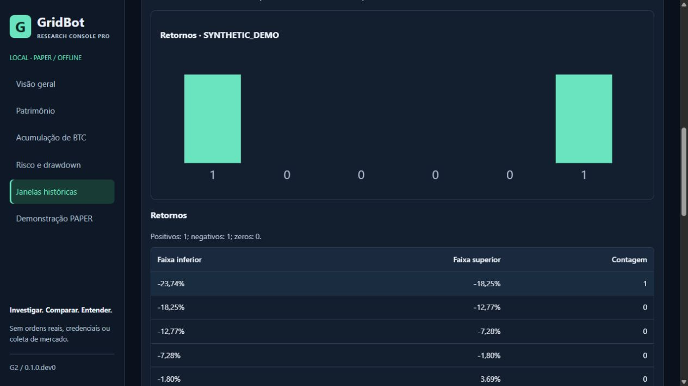

# G2 — Research Console Pro: implementação e auditoria

Data de execução: 23/10/2026, ambiente local Windows/Python 3.13.16.
Escopo: consulta e apresentação de resultados existentes; PAPER/offline.
Auditoria técnica assistida por IA, sem certificação externa independente.

## 1. Baseline e diagnóstico G1

Checkout público iniciou limpo em `feat/g1-research-console`, HEAD
`5b7244fa0c79457dc18238bfe7245e9226e62542`, após implementação `cdd4d1f`.
Main público permaneceu `a28e6f35b7b0acb42cee6dc97959cdf65f6022b0`.
Original somente leitura: `528f8c40ce6f74f9440444b2e652c56fae222fb2`.
Branch de trabalho criada a partir da G1: `feat/g2-research-console-pro`.

Lidos relatório G1, documentação, README, todos os módulos UI, testes G1,
contratos de risco/dados, M1/M1.R/M2, exemplo PAPER e documentos de publicação,
dependências e segurança. As seis páginas G1 foram abertas antes das alterações.
Os 56 casos G1 foram reproduzidos: 56 PASS em 19,09 s; limite 120 s.
Números antigos de cobertura não foram assumidos como nova execução.

| Achado confirmado | Impacto | Tratamento G2 |
| --- | --- | --- |
| Padding genérico do domínio permitia topo DD positivo e BTC negativo artificial | Alto, interpretação | Domínios específicos, testes de extremos e rótulos |
| Referências fixas e diferenças pouco exploráveis | Alto, comparação | Referência/subconjunto, unidades USDT/pp/BTC e decomposição |
| Filtros históricos desabilitados na demo e estado acoplado | Médio, compreensão | Controles separados e estado histórico persistente |
| SVG com desenho fixo e texto pequeno, uso desigual do espaço | Médio, leitura | Redesenho por largura, eixos legíveis, grids responsivos |
| Explorador restrito à seleção sem busca/ordenação | Médio, consulta | Catálogo existente paginado, busca e ordenação exata |
| Exports e proveniência pouco detalhados | Médio, rastreabilidade | CSV/JSON/SVG e metadados explícitos |
| Repetição de processamento ao alternar páginas/filtros | Médio, latência | LRU limitada e hash-aware, sem relaxar admissão |
| Navegação legítima inicial no Brave recebia 403 | Médio, acesso local | Exceção estrita para GET / de navegação de documento |

O último achado foi reproduzido com Host correto, Origin ausente e
Sec-Fetch-Site cross-site em navegação de documento. A API não foi liberada.
O defeito dos domínios foi confirmado pelo código/fórmula e pelos testes;
não há captura anterior de cada valor de eixo. Não se atribui às screenshots
uma prova que elas não registraram.

## 2. Mudanças efetivas

Layout escuro preservado, textos secundários 13–14 px, cards legíveis, menu
lateral, filtros flexíveis, gráficos principais maiores e secundários em grid.
Redução a uma coluna em telas estreitas. Tabelas largas rolam somente dentro
de contêiner próprio. Estado de carregamento retira números antigos dos novos
filtros. Proveniência e limitações acompanham seleção e downloads.

Sem estratégia, parâmetro econômico, threshold de testes ou dependência de
execução nova. Node executa testes puros; Prettier já em cache foi usado offline
como ferramenta de formatação. Não é necessário npm install para usar o console.

## 3. Arquitetura

`data.py`: admissão/hash/projeção, agora com JSON sem chaves duplicadas,
decimais ASCII finitos e magnitude representável, contagens e revalidação.
`analysis.py`: novo módulo puro Fraction para diferenças, extrema, intensidade,
frequências e histogramas sintéticos. Não gera fills/ordens ou políticas.
`server.py`: rotas fixas, seleção, cache e export. `state.js`: preferências e
ordenação exata BigInt. `charts.js`: domínios, desenho, cursor e SVG.
`app.js`: navegação e componentes. Sem duplicar NAV/DD financeiro no frontend.

`risk.py`, `demo.py`, exemplos e módulos financeiros nativos permaneceram iguais
à G1. Novas métricas derivadas de apresentação existem em `analysis.py`;
não seria correto afirmar que nenhum novo cálculo foi adicionado. Ele compara
resultados já admitidos e verifica identidades, sem mudar resultados de origem.

## 4. Antes/depois visual

As capturas anteriores G1 permanecem em `docs/images/g1-synthetic-*.png`.
A captura adicional de baseline PAPER, com os controles históricos vazios,
ficou na evidência local restrita. As capturas G2 abaixo são reais, obtidas
na aplicação em execução; nenhum mockup ou resize fingindo outro viewport.



Legendas numeradas e traços diferentes evitam depender exclusivamente de cores.
Foco visível, skip link, nomes acessíveis e consulta por teclado foram adicionados.
Teste automatizado de contraste da paleta normal: razão >= 4,5:1. Isso não
constitui certificação completa WCAG ou teste exaustivo com leitor de tela.

## 5. Filtros

Fonte, data, horizonte, custo, foco, referência e políticas persistem em
sessionStorage na mesma aba/sessão; não se armazenam séries ou paths.
Combinações são normalizadas a registros existentes, sem simulação para lacunas.
Referência não pode ser retirada do subconjunto. Restaurar seleção usa padrão
válido. A demo tem cenário separado e oculta filtros históricos.

No navegador foi selecionado 2021-12-02 / 6 meses / CA, foco P_BANDS, referência
B1_HALF, DCA oculto. Navegação por PAPER e risco, seguida de reload, preservou
esses valores e manteve o DCA oculto. A referência continuou incluída.

## 6. Comparador

Contas exigem mesmos start/end/cost/months e igualdade racional de capital
inicial/mark final. Duplicidade de política ou referência ausente é recusada.
Tabela: NAV, retorno, BTC físico/equivalente, caixa, MDD, exposição, fees e
diferenças. Extrema/empates identificados por métrica, sem score geral.

Oráculos/testes independentes verificam:

```text
ΔNAV = NAV_política − NAV_referência                 [USDT]
Δretorno = 100 × ΔNAV / capital inicial               [pp]
ΔBTC = BTC_política − BTC_referência                  [BTC]
ΔNAV = ΔBTC × mark final + Δcaixa                     [USDT]
excesso = 100 × max(MDD − 1/5, 0)                     [pp]
```

Delta de retorno em pp não é retorno relativo percentual da estratégia.
Maior DD/fee não é melhor; setas indicam magnitude, não recomendação.
Na demo o comparador pareado é explicitamente indisponível, pois os caminhos
de preços dos dois cenários são diferentes.

## 7. Patrimônio

NAV permanece igual ao arquivo e à identidade caixa + BTC × mark.
Eixo padrão absoluto com zero; opção de ajuste explicita corte e limites.
Nenhuma escala normalizada é apresentada como patrimônio absoluto.
Tooltip usa instante observado e valores de cada série naquele instante;
ausência não é interpolada. Lacunas maiores que um dia interrompem o traço.

Exemplo solicitado, 2022-12-02 → 2024-12-02, 24 meses, CA, B0_BH:
UI confirmou 56.960,38 USDT, BTC físico 0,58610 e MDD 26,15%.
Valores vêm do arquivo; não são constantes de exibição codificadas.
Admissão usa dados exatos, não esses arredondamentos visuais.

## 8. BTC físico, equivalente e divergência patrimonial

BTC físico e NAV/mark são grandezas distintas e aparecem separadamente;
reservas não são adicionadas ao NAV e inventário não é CORE pessoal.
Exemplo real reconciliado em Fraction e conferido na UI:

| Campo | P_BANDS contra B1_HALF, 2021-12-02 / 6m / CA |
| --- | ---: |
| NAV P_BANDS | 7448.1387153822000 USDT |
| BTC P_BANDS | 0.11243 BTC |
| Caixa P_BANDS | 4097.0692484822 USDT |
| ΔBTC | +0.02509 BTC |
| ΔBTC × mark | +747.8282747 USDT |
| Δcaixa | −916.7650796304 USDT |
| ΔNAV | −168.9368049304 USDT |

Somar os dois componentes reproduz exatamente o ΔNAV negativo.
Mais BTC físico coexiste aqui com menos caixa e menor patrimônio; não indica
moedas negativas, perda de conservação ou mark diferente. Não é seleção de
política vencedora ou evidência nova de eficácia.

## 9. Risco

Topo DD exatamente 0 e linha analítica −20%. Classificação em Fraction antes
do arredondamento, MDD como magnitude. Pico/vale, recuperação/censura, episódio,
tempo amostral abaixo do pico, intensidade pp e frequência por horizonte/custo.
Contrato G1/M1.R preservado, incluindo empates de pico/vale.



A tela informa: limite de referência analítico, não mecanismo garantido de
proteção. Não se implementou stop-loss; marcas diárias não provam risco intradiário.

## 10. Multidatas

Catálogo: 4.266 registros, 237 janelas × seis políticas × três custos, sem criar
novas janelas. Busca explícita por botão/Enter, ordenação por data/NAV/retorno/
DD/BTC, filtro horizonte/custo/subconjunto e paginação 18. Ordenação decimal
BigInt evita trocar resultados próximos por perda de precisão Number.
Busca sem correspondência mostrou 0–0; busca 2024 nos sintéticos retornou duas
linhas; ordenação NAV crescente mostrou 76,26 e 109,17.

Seção 8 da autorização limita **novas análises** a artefatos públicos auditados
ou dados sintéticos. M1 privado não foi copiado para contornar esse limite.
Novas distribuições M1 retornam UNAVAILABLE / PUBLIC_AUDITED_CORPUS_NOT_DISTRIBUTED.
Implementados histogramas/contagens somente dos dois cenários SYNTHETIC_DEMO.
São demonstração de UI, não amostra histórica ou estimativa probabilística.
Dispersão/heatmap e estatísticas novas do corpus privado ficam fora da entrega.



Frequências M1 já presentes na G1 permanecem consulta local autorizada e
separada por horizonte/custo. Sobreposição não é independência nem projeção.

## 11. PAPER

Motor anterior reutilizado, sem alteração de comportamento ou preços.
Dois cenários de três minutos fictícios/100 USDT independentes, incluindo perda.
Timeline distingue preparação/reserva de liquidação, tabelas mostram ordem/fill,
lado, quantidade, preço fictício, fee e saldos disponíveis/reservados.
Conservação Fraction residual zero e replay nativo conferidos pelo exemplo/testes.
Primeira execução explícita, feedback de carregamento, erro sem traceback;
não há botão LIVE ou chamada financeira.

## 12. Proveniência e corrupção

Fonte, dataset, janela, custo, unidades UTC/BTC/USDT/ratio/pp, manifesto e
integridade acompanham respostas. Pin M1.R fixo e verificação hash+tamanho;
catálogo distingue matrizes verificadas de curvas sob seleção.
Cache hit não dispensa revalidação. Testes alteram mesmo tamanho de chunks,
matriz, índice e manifesto em fixtures isoladas: corrupção é recusada.
JSON duplicado, série incompleta/futura, preço negativo e representação decimal
insegura são recusados. Não foram corrompidos artefatos originais reais.

UI foi operada com fixtures temporárias locais de fonte ausente e hash divergente:
patrimônio indisponível e evidência recusada, respectivamente; sem números
antigos ou substituição fictícia. Servidores dessas fixtures foram encerrados.

## 13. Exports

CSV, JSON e SVG baixados realmente pela UI no navegador integrado, somente
SYNTHETIC_DEMO. CSV/JSON preservam strings exatas; SVG serializa imagem local
com fonte/unidade/legenda e descrição da seleção, sem script/recursos externos.
CSV inclui referência/deltas quando pareados; campos vazios na demo não pareada.
Whitelist elimina campos privados extras; nenhum caminho Windows nos exports.
Um detector inicial amplo confundiu namespace XML `http://` com drive Windows;
inspeção demonstrou falso positivo e o padrão foi corrigido, sem esconder paths.

CSV exporta resumos do subconjunto da seleção, não a paginação do explorador;
JSON exporta a seleção projetada, não ledgers/candles. Sem escrita na origem ou
diretório arbitrário pelo servidor. Downloads históricos podem conter resultados
da pesquisa autorizada: operador deve revisar antes de compartilhar. Não são
dados financeiros pessoais de carteira real.

## 14. Segurança

Bind exclusivo 127.0.0.1; Host/Origin; sessão efêmera HttpOnly/SameSite=Strict;
APIs same-origin, CSP, anti-frame, nomes de arquivos/rotas fixos, limites de
leitura/descompressão e recusa de links/rede/origens corporativas.
Exceção de navegação somente GET / + navigate + document; iframe e API
cross-site continuam 403, com regressões dirigidas.

Sem credenciais, trading, Binance, testnet, LIVE, coleta ou rede financeira
executada pela UI. Nenhum diretório corporativo foi acessado. Não houve varredura
global do disco. Consulta GitHub foi apenas de leitura para main/Actions.
Servidor não é sandbox contra adulteração por usuário local nem serviço de
produção; não deve ser exposto por proxy. Não é auditoria de todo o host.

## 15. Performance e limites da medição

O acervo possui **1.730.196 marcas**, não somente as 46.134 da amostra G1/G2.
Inicialização carrega resumo/índice; curvas selecionadas são lazy. LRU máxima
quatro seleções completas, chave origem/versão/data/horizonte/custo/hashes.
Reference/subset são projeções de cópias, sem contaminar contas/custos/cache.

Medição local delimitada, sem backtest novo:

| Medida | Observado |
| --- | ---: |
| Inicialização/admissão do catálogo, sem tracing | 0,3851 s wall |
| Seleção fria seis contas 2022-12-02 / 24m / CA, com tracemalloc | 1,5502 s wall; 1,5469 s CPU |
| Cinco seleções quentes, com tracemalloc | 0,0828–0,0998 s wall |
| CPU dessas seleções quentes | 0,0781–0,1094 s |
| Alocação Python corrente/pico na fase selecionada | 3.884.926 / 17.290.480 bytes |
| Amostra do processo real após navegação | working set 74.108.928; private 63.045.632 bytes |

Tracemalloc começou **após** preload; não mede RSS completo. Memória do processo
é snapshot, não pico. CPU acumulada observada 5,96875 s não é custo isolado da
navegação. Leituras frias/quentes dependem cache SO/disco; n pequeno, uma máquina.
Tempos de ações UI ~0,87–1,2 s incluem transporte/espera da ferramenta, não são
medida isolada de paint nem garantia de responsividade. Não foi coletado trace
de frames/long tasks do navegador; esse perfil permanece uma limitação.

Metodologia reproduzível: novo processo, perf_counter/process_time em torno de
Archive + Service.selection; repetir mesma seleção cinco vezes; medir tracemalloc
em escopo explícito; registrar SO/Python/cache quente e snapshot do processo.
Para escala, variar seleções existentes e limitar LRU; não carregar todas as
trajetórias nem reexecutar estratégias. Todos os pontos selecionados são SVG;
um corpus com muito mais pontos exige medição antes de mudar renderização.
Sem meta inventada, extrapolação de throughput ou prontidão para produção.

## 16. Testes efetivamente executados

**50 casos novos:** 35 Python parametrizados e 15 JavaScript.
Original `test_console.py` com 56 casos permanece igual.

| Grupo | Resultado final | Limite |
| --- | --- | --- |
| G1 antes da implementação | 56 PASS, 19,09 s | 120 s |
| Console G1+G2 corrigido com cobertura de ramos | 91 PASS, 52,16 s | 120 s |
| Arquitetura, métricas, higiene e demo pública | 322 PASS, 16,50 s | 120 s |
| Node tests, domínio/nearest/estado/ordenação/contraste | 15 PASS | 30 s |
| Ruff check / format | PASS; 276 arquivos formatados | 60 s cada |
| Mypy | PASS; 260 fontes | 120 s |
| pip check | PASS | limitado |
| Prettier offline | PASS | 60 s |
| Pre-commit all-files / staged | PASS | 120 s |
| Gitleaks histórico curado | PASS; zero achados, seis commits até implementação | 60 s |
| Git fsck | PASS; blobs soltos preservados, sem erro de objetos | 60 s |

Total distinto nesta validação: **413 Python + 15 JS = 428**.
Não somar novamente os 56 do baseline às repetições dos mesmos casos.
Inclui contratos de comparação/tempo/unidades, exatidão e conservação,
corromper cache aquecido, filtros inválidos, fonte indisponível, network guards
da demo, proteção HTTP, determinismo/replay e exports redigidos.
Não equivale a executar toda a suíte financeira ou testar todas as ameaças.

Falhas intermediárias preservadas: formatação JS fora do padrão corrigida;
CSV sintético após adicionar deltas falhou (90 PASS / 1 FAIL), pois comparison
é None para trajetórias diferentes. Corrigido com comparação opcional e mesma
regressão reexecutada: 91 PASS. A rodada falha não foi convertida em PASS por
ter atingido cobertura. Tentativas UI com nome de controle/opção inexato foram
corrigidas após inspeção; não eram falhas econômicas nem testes aprovados.

## 17. Cobertura

Cobertura dirigida final **96,14%** combinando linhas/ramos de research_console;
509 statements, 18 linhas ausentes; 112 ramos, seis ausentes. analysis 100%,
data ~98%, demo 100%, risk ~93%, server ~96%, startup ~85%.
Ramos restantes incluem mensagens defensivas, startup/interrupção e guardas.
Não foram excluídos para elevar número. Threshold 85% e Hypothesis CI 300 intactos.
Cobertura global histórica permanece **PENDING**, sem nova suíte monolítica longa.

## 18. Validação visual real e limitações ambientais

Seis páginas operadas em Brave com viewports CSS reais **1920×1080, 1366×768
e 540×900**. Verificações DOM de overflow global, limites dos textos SVG,
unidades e controles; navegação, filtros, referência/subconjunto, reload,
tooltip por setas e busca/ordenação conferidos por ações reais.
Sem overflow horizontal global observado; tabelas têm overflow intencional.

Brave estava com zoom preexistente 80%: solicitou-se tamanho compensado e
verificou-se innerWidth/innerHeight; zoom não foi alterado. Tentativa intermediária
1366×767 foi registrada e repetida com 1366×768. Viewport foi restaurado e a
aba temporária fechada. Captura Brave expirou em Page.captureScreenshot (5 s),
e download não gerou evento na ferramenta: limitações registradas, não PASS.

Capturas e downloads reais funcionaram no navegador integrado. PNGs foram
obtidos em viewport padrão desse navegador (DOM 1280 px, imagem 1264×712),
incluindo rolagem natural para mostrar gráfico de risco/histograma.
Não são screenshots nas três resoluções Brave; ali a prova é DOM/layout.
CSS de filtros sintéticos foi refinado após identificar encaixe ruim na captura
integrada e novamente verificado sem overflow. Não se afirma inspeção de todos
os pixels, leitores de tela ou execução em todos os browsers.

Roteiro manual: nas três resoluções, abrir seis páginas, selecionar mesma
janela/custo, trocar referência/subconjunto e navegar/recarregar; verificar
zero DD, −20%, BTC >=0, domínio NAV, setas do tooltip; demo, fonte ausente e
fixture inválida; buscar sem resultado, ordenar e baixar CSV/JSON/SVG sintéticos.
Instruções de execução em [RESEARCH_CONSOLE.md](../RESEARCH_CONSOLE.md).

## 19. Preservação financeira e original

Repetida admissão dos 4.266 resumos e reconciliação das mesmas 18 seleções
(2020-01-02 e 2022-12-02 × três horizontes × três custos): **108 carteiras e
46.134 marcações**. Identidades NAV/retorno/BTCeq e perfis de risco conferidos;
campos de risco iguais aos arquivados. Sem reexecutar backtests. Essa amostra
técnica não verifica todas as 1.730.196 trajetórias nem prova eficácia econômica.

Rehash de **1.665 arquivos** originais contra baseline anterior: zero diferenças.
HEAD original 528f8c4, sem remote, seis históricos não rastreados iguais.
Manifesto V2 FINAL preservado, SHA-256
`44e9639554d01c13e2e0648613e7904a6f1649ca934b00b3821021aa28582249`.
Diff contra G1 de src, exemplos, risk/demo, constraints/build-constraints,
pyproject e LICENSE vazio. 104 módulos nativos preservados. Relatórios e
datasets originais não foram sobrescritos; novos screenshots somente sintéticos.

## 20. Git e evidências

Trabalho exclusivo na cópia pública, branch feat/g2-research-console-pro.
Commit de implementação/testes/docs de uso: `d7aac03`.
Segundo commit local: auditoria/evidências e proposta de PR.
Hashes concretos no fechamento da entrega e `git log`; não se embute o hash de
um commit dentro dele próprio. Nenhum push, PR remoto, merge ou perfil alterado.
Consulta remota de leitura confirmou main a28e6f3 e Actions enabled=false.

Resumo público sanitizado: [G2_VALIDATION_SUMMARY.json](G2_VALIDATION_SUMMARY.json),
com contagens/medidas, hashes das capturas e recibos dos testes (incluindo falhas).
Logs completos, hashes de preservação e observações DOM permanecem no diretório
de auditoria local privado da missão; não se adicionam corpus ou paths privados
a exports/UI. PR preparado em [G2_CHANGELOG_AND_PR.md](../G2_CHANGELOG_AND_PR.md).

## 21. Pendências explícitas

- Cobertura global PENDING, sem afirmar gate global aprovado.
- Corpus M1 privado não distribuído; novas estatísticas históricas indisponíveis.
- Sem análise intradiária, garantia de drawdown, inferência IID ou previsão.
- Captura Brave indisponível; screenshots integradas reais e teste DOM de resoluções.
- Sem trace de paint/CPU por interação, stress multiusuário ou teste Linux/macOS.
- Nenhum novo resultado econômico nem superioridade ativa demonstrada.
- Nenhum novo importador de corpus genérico ou grande infraestrutura de imagem.

## 22. Recomendação e fechamento

Recomenda-se revisão humana do diff, UX e documentação e reprodução dirigida
antes de eventual autorização separada de publicação. A G2 cumpre consulta local
com limitações explícitas; não autoriza trading, coleta prospectiva ou G3.
Conclusões econômicas negativas e protocolo congelado permanecem preservados.

Pre-commit all-files e hooks staged aprovados; Gitleaks histórico sem achados;
Git fsck sem corrupção (blobs dangling informativos preservados, sem gc).
Rodada final de layout após refinamentos: 18 combinações página/resolução,
zero overflow global ou rótulos SVG horizontalmente cortados.
CSV corrigido novamente baixado pela UI: origem sintética, deltas presentes,
valor exato preservado e sem caminhos locais. Log de erros JS da aba integrada
consultada vazio. Fixtures encerradas; uma instância manual loopback ficou
aberta para revisão. Nenhum serviço permanente instalado.

`G2_RESEARCH_CONSOLE_PRO_PASS`

`FINANCIAL_RESULTS_PRESERVED`

`ORIGINAL_GRIDBOT_PRESERVED`

`FROZEN_V2_PRESERVED`

`REAL_TRADING_DISABLED`

`GITHUB_PUSH_NOT_PERFORMED`

Entrega pronta para revisão local dentro dos limites acima; publicação depende
de autorização separada. G3 não iniciado.
