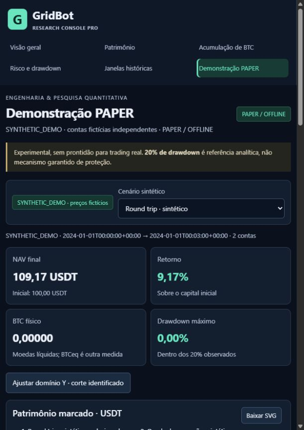

# G3.2 — Release Integration & Publication Readiness

23/10/2026. Auditoria técnica local assistida por IA, Windows/Python 3.13.16.
Candidata de publicação **via revisão humana**, sem push, PR, merge, tag,
release, Actions ou autorização para trading. Nenhuma nova pesquisa econômica.

## 1. Baseline e reconciliação obrigatória

Entrada limpa: `d2cdf2fb537a26e3caf4c0bc05658c4dbac144e0`, branch
`fix/g3-global-quality-gate`. Lidos G1/G2/G3/G3.1, changelogs/PRs, README,
instalação, segurança, configuração, histórico e manifestos completos em JSON.
Foram novamente conferidos os 2.446 hashes de referências de artefatos G3.1.

| Inventário | Python PASS | JS PASS | Python pendente | SKIP |
| --- | ---: | ---: | ---: | ---: |
| G3 | 1.987 | 19 | 1.425 | 2 |
| G3.1 | 3.420 | 19 | 0 | 2 |
| G3.2, união auditada com revalidação afetada | 3.420 | 19 | 0 | 2 |

Os **2.006 PASS G3 eram 1.987 Python + 19 JS**. A G3.1 adicionou oito casos
Python de infraestrutura. A conta correta é:

```text
2.006 − 19 + 1.425 + 8 = 3.420 Python PASS
3.431 mistos − 3.420 Python = 11 = 19 JS − 8 novos Python
```

G3 tinha 3.414 nodeids Python; G3.1/G3.2 têm 3.422. Comparação exata das listas:
zero removidos/renomeados/omitidos; os oito adicionais pertencem aos dois módulos
test_quality. Todos os 1.425 antigos pendentes constam como PASS. Os segmentos
certificados têm proprietários disjuntos. Parametrizações são nodeids, não
exemplos Hypothesis; nenhum novo nodeid foi criado na G3.2. A regressão HTTP
existente foi ampliada para validar versão e proveniência de qualidade.

Skips globais preservados: chmod POSIX no Windows e criação real de symlink sem
privilégio. O segundo voltou a ser SKIP no console; o primeiro conserva sua
evidência G3.1. Nenhum novo skip/xfail ou teste desabilitado.

## 2. Identidade e alcance da cobertura

Nativa G3.1: **96,52624362001981%**, source `gridbot`, branches, threshold 85%,
104 módulos, 264 bancos completos, 10.155/10.415 statements e 2.516/2.712 ramos.
O relatório original retornou exit 0. Manifesto SHA-256:
`95ae29861252e6068d3684da22f06d0b168d43af5efcd54ce6ab7ee85d1eeb02`.

A G3.2 preserva todos os bytes dos fontes nativos, pyproject/configuração coverage,
oráculos financeiros e versões Python/coverage/pytest/Hypothesis e runtime
numérico. Não foi reexecutada nem anunciada uma suíte monolítica nova.
A medição é **evidência arquivada equivalente para os mesmos fontes nativos**.
Não se alterou identidade de banco para forçar aceitação nem se fez novo merge
com dados de UI. Percentuais não foram somados/promediados.

A identidade ampla do tooling G3.1 não é declarada inteiramente igual: mudaram
`research_console/server.py` e `constraints.txt`; além disso, app.js mudou e
test_console.py ganhou assertions. A diferença de constraints é exclusivamente
o pin **dev** filelock. Todas as fontes console foram reexecutadas, e o tooling
afetado pelo pin foi revalidado. Os bancos históricos continuam imutáveis.

Console atual, fonte separada `research_console`: **95,46079779917468%**,
591 statements e 136 branches. Esse percentual não integra os 96,53% nativos.
A UI identifica escopo, ambiente, threshold e caráter arquivado; diz explicitamente
que CI remoto não foi executado. Não há badge de Actions aprovado.

## 3. Branches e integração

| Linha | HEAD de referência |
| --- | --- |
| main pública/local | a28e6f3 |
| G1 | 5b7244f, após cdd4d1f |
| G2 | 2171548, após d7aac03 |
| G3 | 183efd7, após 8d36b59 e 9db8af1 |
| G3.1 | d2cdf2f, após c14aa50 e 5cd2e66 |
| G3.2 candidata | `release/g3-research-console` |

`merge-base --is-ancestor` confirmou cada ligação. A candidata foi criada sobre
d2cdf2f. Todas as funcionalidades já estão na cadeia linear: não houve merge
artificial, cherry-pick, rebase, reset, descarte de evidência ou force-push.
A main continua intacta. O teste de primeiro uso fez clone **local** dessa cadeia;
isso não afirma que a main GitHub antiga já contenha o console.

## 4. Estado do código e escopo funcional

Revisão cumulativa apoiada nos audits G1–G3.1 e na identidade dos arquivos:
Python financeiro preservado; UI/JS/CSS, segurança, exemplos, testes, scripts e
empacotamento correspondem aos componentes auditados. G3.2 altera somente a
apresentação do estado de qualidade, versão do catálogo obtida do pacote instalado,
assertions correspondentes, documentação, evidências e um pin de desenvolvimento.
O manifesto integral registra os arquivos efetivos e o delta desde main.

Nenhuma regra BUY/SELL, capital, fee, quantização, geometria, benchmark, política,
CORE, V2, dataset ou resultado econômico mudou. Sem Binance, LIVE/Testnet,
credenciais, coleta prospectiva, otimização ou novos backtests históricos.

## 5. Segurança e achado de dependência

A consulta OSV completa de **38 pins públicos** retornou um advisory para
filelock 4.0.12. O pin foi atualizado para **4.2.1**, cuja distribuição oficial
foi conferida no PyPI. O problema descrito envolve ReadWriteLock SQLite em
condições de escrita por outro usuário local em POSIX; não se demonstrou
exploração no GridBot e o caminho Windows testado não é o descrito.
Fonte primária: [advisory do mantenedor](https://github.com/tox-dev/filelock/security/advisories/GHSA-v4x8-3wr5-3wq8).

Filelock pertence ao ambiente de desenvolvimento; não foi adicionada dependência
ao wheel de runtime. Instalação vazia com o pin corrigido, pip check e 28 casos
de tooling/CLI/higiene passaram. Nova consulta de 38 pins em 23/10 às 22:37 UTC
terminou sem correspondências retornadas. Isso não certifica ausência de CVEs,
pacotes maliciosos ou falhas fora do banco consultado.
[Método oficial querybatch](https://google.github.io/osv.dev/post-v1-querybatch/).

Gitleaks verifica histórico completo, inclusive commits não publicados, e árvore
publicável; os dois JSON.gz de qualidade são descomprimidos e inspecionados
separadamente. Nomes/caminhos e conteúdo são revistos no conjunto publicável.
Logs brutos, venvs, wheels, bancos coverage, corpus e relatórios internos não
entram no Git. O manifesto financeiro público de proveniência não é o V2 FINAL
interno. Literais sintéticos de ACL/cloud-sync e guardas de origem não são
caminhos pessoais coletados nem documentos corporativos.

Autor/proveniência profissional já públicos permanecem; não houve acesso ao
diretório corporativo proibido ou leitura de registros empresariais. As imagens
novas foram inspecionadas: somente dois cenários fictícios, sem dados pessoais.
A configuração habitual excluía constraints; uma configuração privada com regras
padrão/Binance e **sem exclusões de caminhos** complementou a revisão. Um ensaio
retornou exit 0, mas registrou ERR ao tratar o nome `.gz.unpacked.json` como gzip:
foi classificado **incompleto**, sem aceitar o exit como aprovação. Os JSONs foram
reposicionados com nomes inequívocos e todo o texto/JSON descomprimido foi também
agregado com índice de hashes para uma varredura integral sem exclusões.
Scanner sem achados não é pentest, auditoria externa ou prova universal de segurança.

## 6. Documentação e apresentação

README prioriza engenharia quantitativa, contabilidade/conservação, console,
risco, demo, testes e instalação. O quickstart usa Python explícito do venv e
launcher manual; explica que a main anterior ainda não tem UI até publicação.
Guia detalha dados ausentes, exports, parada e versão. TESTING distingue as
rodadas históricas do estado atual. Relatórios anteriores permanecem intactos.

Conclusão econômica mantida: estratégias ativas examinadas não demonstraram
vantagem robusta suficiente sobre benchmarks. Não há rentabilidade garantida,
proteção de DD futura ou autorização para dinheiro real. Nenhuma formação,
experiência ou competência profissional nova foi inventada.

Changelog/descrição de PR consolidam **todo o delta desde a versão pública**,
e não apenas G3.2. Capturas reais e checklist de aprovação acompanham a candidata.

## 7. Instalação, pacote e primeiro uso

Clone local novo em caminho com espaço/acento, venv dedicado, pip 26.2.1 e
instalação documentada `-c constraints.txt --build-constraint build-constraints.txt
-e .[dev]` via PyPI passaram. Após corrigir filelock, outra instalação em ambiente
vazio passou, com as versões finais. Não se reutilizou o venv antigo como prova
de instalação limpa. A versão instalada e o CLI são **0.1.0.dev0**.

Wheel final: **126 membros**, 104 módulos nativos iguais ao source público,
console/assets e exemplos; sem testes/tools/docs/corpus privados.
README UTF-8 embutido foi comparado ao documento final. SHA-256:
`3cb2482caf7cdcf43c56087dd584115d367e6d19263709410a32585a9f5368ae`.
O wheel preliminar foi preservado, mas não é o artefato final indicado aqui.

Instalado em outro venv e exercitado **fora do checkout**: imports, entrypoint,
HTTP/assets, sessão, origem, demo e JSON/CSV. Tempo observado no wheel final:
0,522 s até primeira resposta, 2,943 s para demo inicial; observações locais,
sem meta/SLA ou inferência de escala. Não é serviço de produção.

O smoke instrumentado recusaria leitura do original/corporativo ou conexão não
loopback; nenhuma tentativa foi observada. A aplicação abriu DATA_UNAVAILABLE,
com catálogo vazio, sem archive-root. Demo exige clique explícito no navegador.
Não há promessa de acesso automático às 4.266 simulações internas.

Oráculo Fraction instalado reconciliou fills/fees e oito marcas dos dois cenários:

| Cenário fictício | NAV final | BTC físico | Caixa USDT | Fees USDT |
| --- | ---: | ---: | ---: | ---: |
| round_trip | 109.17147000 | 0.000 | 109.17147000 | 0.28853000 |
| falling_mark | 76.26013000 | 0.946 | 10.04013000 | 0.08987000 |

Cada conta começa com 100 USDT; não são janelas agregadas. Conferidos
NAV = caixa + BTC×mark, disponível + reservado = caixa, não negatividade,
BTCeq, DD e fees; reservas não são somadas de novo ao patrimônio. JSON e CSV
fazem round trip exato; rerun reproduz a seleção. O comparador demo recusa
pareamento de trajetórias diferentes, sem inventar benchmark.

SVG: código não mudou na G3.2; preservadas prova G3 de download/reimportação/render
e regressões Node de metadata/projeção. A nova rodada não é anunciada como outro
download SVG reimportado do navegador. CSV foi acionado na UI; bytes JSON/CSV
foram conferidos pelo HTTP instalado, com escopos explicitamente separados.

## 8. Compatibilidade, launcher e capturas

Windows/Python 3.13.16 e Node 24.19.0 efetivamente usados. CMD do clone foi
iniciado de outro cwd, abriu o console e executou a demo no navegador. Ctrl+C
solicitou confirmação de término do batch, respondida S; o host PTY retornou
**1 por interrupção**, não exit 0. Porta liberada e sem traceback. PowerShell
teve parser sem erros; não se afirma nova operação interativa em 5.1.
Nenhuma ExecutionPolicy, privilégio, serviço ou inicialização global mudou.

Seis páginas operadas na instância sem origem privada: overview, patrimônio,
BTC, risco, janelas e PAPER. DD de perda 27,12%, topo zero, referência −20%,
BTC físico 0,946 e BTCeq distintos; ausência histórica explícita. Capturas novas
são **JPEG 611×863 reais**, sem resize/edição/IA/Full HD simulado:



[Risco sintético](../images/g3_2-synthetic-risk.jpg) ·
[Proveniência e qualidade local](../images/g3_2-local-validation.jpg).

Capturas G1/G2/G3 continuam com seus hashes e limites históricos. Linux/macOS,
leitor de tela, todas as ordens monolíticas e ensaio de carga/heap longo não
foram demonstrados. O processo manual anterior não foi encerrado; os novos
processos de validação e a aba temporária foram encerrados.

## 9. CI e verificações efetivas

Actions remoto confirmado `enabled=false`. Nenhum YAML executável em
`.github/workflows/`. A proposta permanece em `ci/github-actions-proposal.yml`,
sem ativação, cron, secret ou token novo.

| Check | Resultado e alcance |
| --- | --- |
| Console completo atual | 136 PASS + um SKIP; 82,85 s pytest, limite 180 s |
| Regressões pertinentes | 338 PASS; 17,76 s, limite 120 s |
| Tooling após filelock | 28 PASS, subconjunto dos 338; 1,09 s |
| JavaScript | 19 PASS |
| Ruff / format / Mypy strict | PASS, 266 fontes Mypy |
| pip check / editable / wheel / smoke | PASS em ambientes delimitados |
| pre-commit / Gitleaks / diff-check / Git | verificados separadamente no fechamento |

Distincts G3.2: **474 Python PASS + 19 JS PASS = 493**, um SKIP no recorte.
Não se adicionam reruns, smokes, exemplos ou passos de UI ao total global.
Os 3.420 Python globais combinam a evidência G3.1 compatível com reexecução dos
componentes afetados; não são milhares de testes reexecutados nesta rodada.

Tentativas não PASS preservadas: seleção com filename incorreto (exit 4, nenhum
teste); helper smoke assumindo campo histórico ausente no schema sintético;
helper de metadata usando decoder MIME incompatível com o corpo UTF-8 real.
Os auxiliares foram corrigidos e seus checks passaram, sem mudar produção.
O verificador de imagens recusou a extensão privada PNG sobre bytes JPEG;
cópias públicas usam assinatura/extensão JPEG corretas, com bytes idênticos.
Pillow não estava instalado; usou-se parser stdlib, sem instalar dependência.
Não houve falha financeira demonstrada ocultada ou convertida em PASS.

## 10. Commits e versão

- `aac88bc`: identificação de qualidade/versão, regressão HTTP e primeiro uso.
- `17c8b14`: patch do pin de desenvolvimento e contexto de segurança.
- Fechamento documental: relatório, manifesto, evidências, changelog e checklist;
  HEAD final na entrega/Git, sem autorreferência circular dentro do commit.

Pacote atual: **0.1.0.dev0**. Proposta de eventual release: **0.1.0rc1**,
não aplicada nem publicada. A candidata técnica é coerente sem trocar a versão
congelada da medição. Antes de tag/release, aprovar bump, atualizar teste de
versão e gerar/validar novo artefato; nunca rotular o wheel dev0 como rc1.

## 11. Remoto e preservação

Main remoto por GET oficial:
`a28e6f35b7b0acb42cee6dc97959cdf65f6022b0`. Só a branch main está publicada;
tags e releases retornaram listas vazias. Origin existente foi conferido, sem
alteração/configuração. Nenhuma operação GitHub de escrita ocorreu.

Original em `528f8c40ce6f74f9440444b2e652c56fae222fb2`, sem remote,
seis históricos iguais e 1.665 hashes sem diferença. V2 FINAL:
`44e9639554d01c13e2e0648613e7904a6f1649ca934b00b3821021aa28582249`.
104 blobs financeiros públicos permanecem iguais à curadoria/original; diferenças
de EOL entre worktrees já eram históricas, não uma alteração desta fase.

## 12. Diferenças e arquivos publicáveis

[Manifesto integral](G3_2_PUBLICATION_FILE_MANIFEST.json): caminhos relativos,
categorias, tamanhos, SHA-256 de bytes Git normalizados, OIDs e delta contra
main. Inclui código, testes, documentação, demonstração, configuração e evidência;
identifica binários/imagens/gzip e arquivos grandes. Sua própria linha não tem
autohash circular; o commit final vincula o manifesto e a árvore inteira.

Sem remoção de arquivos ou datasets adicionados. Dependências runtime iguais;
contra main há acréscimo de editables ao build (G3) e patch dev filelock (G3.2).
Entrypoint console e inclusão de console/examples no wheel são os ajustes de
empacotamento cumulativos. Scripts novos são launchers manuais e ferramentas
QA. CI proposto continua não executável. Não entram venv/cache, wheelhouse,
logs brutos, SQLite coverage, corpus, V2 interno ou arquivos corporativos.

## 13. Riscos e decisões remanescentes

Sem superioridade econômica demonstrada, garantia de DD, certificação externa,
produção multiusuário ou trading real. Evidências globais são segmentadas e em
parte reaproveitadas sob identidade financeira comprovada; duas limitações de
skip e plataforma permanecem. Consulta OSV tem cobertura limitada e validade
temporal. Instalação requer disponibilidade de pacotes oficiais; pins não são
um lock criptográfico completo da cadeia de distribuição.

Aprovação de branch/PR não autoriza merge, release, bump de versão, Actions,
coleta ou nova estratégia. Conferir novamente main e advisories antes de uma
operação remota futura. Se main divergir, revisar integração, sem force-push.

## 14. Recomendação e checkpoint

**Candidata pronta para publicação de branch e abertura de PR após autorização
explícita do usuário/orquestrador.** Merge e release são etapas separadas.
O PR preparado descreve a evolução completa desde a28e6f3, com limites claros.

- [Changelog e descrição de PR](../G3_2_RELEASE_CHANGELOG_AND_PR.md).
- [Checklist com quatro autorizações separadas](../G3_2_PUBLICATION_CHECKLIST.md).
- [Resumo de testes, identidades e tentativas](G3_2_VALIDATION_SUMMARY.json).
- [Manifesto de arquivos](G3_2_PUBLICATION_FILE_MANIFEST.json).
- [Instalação](../RESEARCH_CONSOLE.md).

```text
G3_2_RELEASE_INTEGRATION_PASS
PUBLICATION_CANDIDATE_READY
GLOBAL_TESTS_PASS
GLOBAL_COVERAGE_PASS
ORIGINAL_GRIDBOT_PRESERVED
FROZEN_V2_PRESERVED
REAL_TRADING_DISABLED
GITHUB_PUSH_NOT_PERFORMED
```

PARE e aguarde revisão do ChatGPT. Nenhuma publicação automática ou G4.
