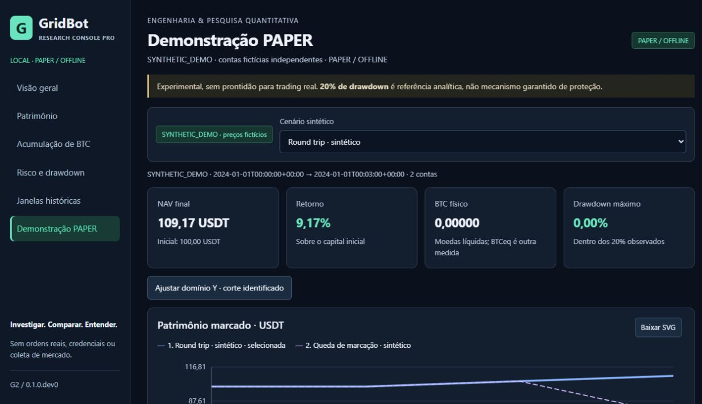

# G3 — Quality Engineering e candidato local para revisão

23/10/2026 · Windows · Python 3.13.16. Auditoria interna assistida por IA.
Oráculos independentes da projeção financeira; não é certificação externa.

## 1. Baseline G2 realmente conferida

Entrada limpa em `feat/g2-research-console-pro`, HEAD
`21715487c3b3ee0498ee738ade9348fd62820658`, após `d7aac03`.
Original somente leitura em `528f8c40ce6f74f9440444b2e652c56fae222fb2`;
seis históricos não rastreados presentes. Worktree público único, sem mudanças
pendentes no início. Não havia listener em 8765; a instância G2 de baseline foi
iniciada nesta auditoria. Nenhum processo preexistente do usuário foi encerrado.

Lidos código Python/JS/CSS/HTML, testes G1/G2, docs G2/PR, empacotamento,
constraints, runner de testes, diagnóstico R1 e contratos M1/M1.R de métricas.
G2 informou 428 testes/96,14%; aqui a baseline **reproduzida** foi 91 testes
do console, PASS em 28,28 s, limite 120 s. Os demais números G2 continuam
históricos, sem serem convertidos em execução nova.

Versões observadas: pytest 9.1.1, pytest-cov 7.1.0, coverage 7.16.2,
Hypothesis 6.168.5, Pydantic 2.13.5, Ruff 0.16.10, Mypy 2.4.0, pip 26.2.1.
Hatchling não estava no venv de execução: build usa isolamento com pins próprios.

## 2. Git e limites de autoridade

Branch nova `feat/g3-quality-release-candidate`, derivada da G2.
Desenvolvimento somente na cópia pública. Original, CORE, políticas congeladas,
V2, corpus e protocolo prospectivo não foram alterados. Nenhuma área corporativa
foi acessada/listada/indexada. Nenhuma varredura global de disco foi realizada.

Sem Binance, credenciais, wallet, LIVE, testnet, coleta, backtest de pesquisa,
otimização econômica, push, merge, release remoto, edição de perfil ou Actions.
Rede externa da missão: instalação/build por PyPI e consultas GitHub de leitura.
APIs e demonstrações do produto utilizaram exclusivamente loopback/offline.

## 3. Mapa de responsabilidades e revisão

| Camada | Responsabilidade |
| --- | --- |
| data.py | Pin, leitura limitada, JSON/UTF-8/schema, projeção, hashes e marcas |
| risk.py | Perfil racional de risco G1/M1.R, preservado |
| analysis.py | Diferenças/identidades de apresentação, comparação e CSV |
| demo.py / examples | Adaptação e execução sintética nativa, preservadas |
| server.py | Loopback, rotas, origem/sessão, cache, erros e exports |
| state.js | Preferências, rotas, ordenação exata e proveniência de apresentação |
| charts.js | Coordenadas, teclado, SVG, tabelas e ciclo de ResizeObserver |
| app.js | Navegação, filtros, requests, componentes e estados da interface |
| tools/audit_console_archive.py | Oráculo QA opcional; lê origem autorizada e HTTP |
| launchers / pyproject | Execução manual e instalação/empacotamento |

Não há ciclo Python introduzido: analysis → data → risk; server usa esses
módulos e demo. O núcleo não importa a UI. Estado global JS permanece limitado
à sessão da interface; caches do servidor são locais à instância e retornam cópias.
Funções grandes continuam em orquestração/render/export e no perfil congelado;
não foi feita refatoração ampla para trocar o estilo arquitetural. A nova
ferramenta de auditoria é deliberadamente separada do produto/wheel.

## 4. Achados demonstrados, gravidade e alcance

| Achado | Classe/gravidade | Reprodução e efeito |
| --- | --- | --- |
| Duplo listener na mesma porta Windows | Bug P2 | LocalServer podia ser construído duas vezes na porta já escutando; teste esperava recusa e falhou |
| Cookie comum a portas diferentes | Bug P2 | Duas instâncias emitiam `console`; browser sobrescreveria a sessão anterior |
| Manifesto M1 mostrado na demo | Bug P2 de proveniência | UI SYNTHETIC_DEMO exibiu hash M1 quando catálogo histórico estava disponível |
| Query vazia descartada | Bug P2 de validação | `unexpected=` e `policies=` retornaram 200, por descarte do parse_qs |
| Navegação sem histórico de páginas | Bug P2 de UX | Após duas páginas URL seguia `/`; voltar saiu da aplicação em vez de retornar à página anterior |
| Identidade incompleta nos exports | Lacuna P2 de reprodução | CSV não levava schema/dataset/foco; SVG não tinha identidade completa verificável |
| JSON profundo/NaN/Infinity admitidos pelo decoder | Hardening P3 | Fixtures aceitaram 1.500 níveis e constantes fora do JSON estrito; pin real impede substituição arbitrária da origem |
| CSV aceitava identidade forjada com fórmula | Hardening P3 | Chamada direta do exporter com objeto adulterado gerou célula perigosa; não foi demonstrado caminho explorável através do corpus pinado |
| Fetch/export sem deadline explícito | Robustez P3 | Ausência confirmada no código; fixture de 16 s validou a recusa e recuperação novas |

Nenhum P0/P1 de contabilidade ou leitura arbitrária permaneceu demonstrado.
Os testes inicialmente vermelhos são evidência dos defeitos, não resultados
aprovados. Não se atribui gravidade remota a casos acessíveis apenas com objeto
adulterado em fixture ou processo local já comprometido.

## 5. Correções implementadas

Bind exclusivo no Windows e desativação de reuse-address; cookie com nome por
porta; parse estrito preservando valores vazios; validação de foco/subconjunto
antes de I/O; tratamento sanitizado de alvo HTTP inválido, asset ausente e
cliente desconectado. Sessões não persistem além do processo/browser.

JSON UTF-8, sem constantes não finitas/chaves duplicadas, profundidade máxima
32, até 250.000 separadores estruturais fora de strings, comprimido até 512 KiB
e descomprimido até 8 MiB. Brackets/escapes dentro de strings não contam como
estrutura. Não há upload nem novo importador CSV: CSV truncado como origem é
explicitamente recusado por formato, não supostamente reparado.

Histórico de páginas via hash/history; filtros continuam compartilhados.
Requests anteriores são cancelados e respostas antigas não substituem seleção
nova; deadline cliente 15 s. Export cancela se a seleção mudou. Observers são
desconectados explicitamente no teardown; não se afirma vazamento acumulativo
de heap anterior que não foi medido. Comparação/identidades usam Fraction.

Proveniência sintética tem ramo próprio e manifesto nulo/não aplicável, inclusive
antes de executar a demo (`NOT_EXECUTED`). Não herda integridade/dataset M1.

## 6. Ponta a ponta no navegador real

Aplicação operada de verdade, não apenas locators para existência de botões:

- Inicialização: root/CSS/JS/estado PAPER; HTTP 200 e assets presentes.
- Seis páginas, um item ativo, voltar/avançar para `#demo`/`#risk`, reload e filtros.
- Três datas, horizontes 6/12/24, custos CA/CB/CX2, foco e referência alterados.
- Duas políticas visíveis e referência trocada para P_BANDS: delta próprio 0,00.
- Risco sintético: NAV 76,26, retorno −23,74%, BTC 0,94600, MDD 27,12%; topo do
  eixo 0 e linha −20%, valores do ponto final consultados por teclado.
- Demo nativa reexecutada explicitamente; JSON antes/depois idêntico byte a byte.
- CSV/JSON/SVG baixados pela UI, reimportados e confrontados com a seleção.

Fixtures locais separadas de fonte ausente, integridade divergente e catálogo
com atraso de 16 s: sem dados inventados, sem números antigos, timeout legível
de 15 s; reload posterior recuperou o modo público sem trocar para demo.
Fixtures tiveram duração finita e foram encerradas. Log de erros da aba final
consultada vazio; não equivale a telemetria de todos os browsers/ambientes.

## 7. Evidências visuais reais

Antes G2, capturado antes de alterar a aplicação:

Depois G3 com tabela numérica e controles testados:

[Captura integral Full HD](../images/g3-paper-full-1920.jpg) ·
[Marcas exatas acessíveis](../images/g3-accessible-marks.jpg) ·
[Risco integral](../images/g3-risk-full.jpg) ·
[SVG exportado aberto no browser](../images/g3-svg-export.jpg).

Todas as imagens distribuídas são SYNTHETIC_DEMO; nenhuma curva privada foi
copiada para tornar o repositório publicável. Imagens são JPEG reais, sem resize,
montagem, mockup ou edição para fingir a resolução. Hashes constam do resumo.

## 8. Resoluções e limite de captura

30 combinações (seis páginas × cinco viewports CSS): **1920×1080, 1366×768,
1280×720, 768×900 e 390×844**. Sem overflow global, controles sobrepostos,
rótulos SVG horizontalmente cortados ou mais de um menu ativo nos checks DOM.
Tabelas largas têm rolagem local intencional. Em 390 px os cards ficam em coluna.
Viewport temporário foi restaurado ao terminar; nenhuma configuração Windows mudou.

Há diferença entre viewport de layout e captura do painel do navegador integrado:
getScreenshot limitou as imagens visíveis largas à largura física do painel
(por exemplo, viewport 1920 gerou JPEG 1239×1072; 390 gerou 375×812).
Isso **não** prova captura completa de 1920×1080. A inspeção nesse tamanho é
DOM/layout; a captura `fullPage` preserva o documento integral no layout solicitado,
com altura de página e scrollbar próprias, não simula um PNG de 1920×1080.
Essas limitações não são escondidas por renomear ou redimensionar imagens.

## 9. Acessibilidade

Títulos com foco após navegação, skip link, foco visível, labels, captions e
scope de colunas; risco tem texto EXCEDEU/dentro observado além de cores.
Gráficos aceitam setas/Home/End e oferecem tabela exata sob demanda, 25 marcas
por página da política em foco. Tabela informa quando valores são ratios.
Gráficos/legendas têm números, traços distintos e política selecionada enfatizada.
Paleta normal passou teste de contraste >= 4,5:1.

Não foi operado leitor de tela nem emitida certificação WCAG. A tabela detalhada
não enumera simultaneamente todas as políticas: comparação agregada e exports
complementam a leitura da política em foco. Não se depende apenas de hover.

## 10. Segurança local

Rotas fixas; sem endpoint de caminho, upload, trading ou escrita de estado
financeiro. Host/Origin, sessão, Fetch-Site, CSP/anti-frame, no-store, nosniff e
read-only permanecem. Somente navegação de documento na raiz pode entrar de
outro site; APIs e frames cross-site continuam recusados. Fonte exige pin fixo,
nomes permitidos, origem local e recusa de links/junctions. Não há CORS remoto.

Teste de quatro clientes/oito leituras simultâneas retornou resultados iguais;
disconnect/export interrompido não tornou o servidor indisponível. Servidor
continua serial/local: isso não é teste de carga de produção. Timeout socket
é de inatividade (3 s); timeout browser é cliente (15 s), não cancelamento de
cálculo já em andamento. Processos locais capazes de adulterar arquivos ou
obter a sessão não são isolados por sandbox/auth multiusuário. Não expor em rede.

Gitleaks/pre-commit staged do código/build aprovados; histórico até os dois commits
de implementação: nove commits, zero achados. Fechamento final também verifica
documentos/evidências antes do commit e histórico resultante depois dele.
Isso não é varredura de CVEs, pentest externo ou auditoria de todo o host.

## 11. Integridade financeira independente

Oráculo `python -m tools.audit_console_archive --archive-root PASTA_AUTORIZADA`:
parser JSON/gzip independente para os bytes admitidos, Fraction para expectativas,
servidor HTTP real em porta efêmera, projeção e exports como objetos sob teste.
Nenhum runner histórico/otimizador foi importado ou executado.

**27 seleções, 162 carteiras, 69.174 marcas**: datas 2020-01-02, 2021-12-02 e
2022-12-02 × 6/12/24 meses × CA/CB/CX2 × seis políticas. Referências B0_BH e
B1_HALF, conforme protocolo determinístico do auditor. Amostra com 93 ganhos,
42 perdas, 27 empates; 135 carteiras com aumento de BTC em algum passo e 48
com redução. Contagens de movimentos podem se sobrepor; não são operações novas.

Verificados a cada marca: UTC/ordem, NAV = caixa + BTC × mark, BTC equivalente,
retorno, exposição e drawdown por high-water mark racional. Exposição média
reconstruída por capital×tempo com amostra à esquerda, conforme contrato M1;
limite de 20% comparado antes de arredondar. Referências compartilham período,
capital inicial, custo e mark. Deltas USDT/pp/BTC e hashes também reconciliados.

Fees históricas foram confrontadas com o resumo de origem, não reconstruídas de
um ledger completo de trades que a UI não serve. Na demo, fees e saldos foram
recalculados independentemente dos fills no smoke instalado. Não se presume
que esta amostra valide todas as 1.730.196 marcas do acervo ou toda a pesquisa.

## 12. API → interface → export e round trips

Cards e oito colunas do comparador confrontados com expectativas Decimal de origem:

| P_BANDS / CA | NAV UI USDT | Retorno | BTC físico | MDD |
| --- | ---: | ---: | ---: | ---: |
| 2020-01-02, 6m | 11.989,62 | 19,90% | 0,72369 | 31,46% |
| 2021-12-02, 12m | 5.838,16 | −41,62% | 0,14727 | 43,38% |
| 2022-12-02, 24m | 26.284,80 | 162,85% | 0,13452 | 14,03% |

Também conferidos CB e CX2 nessa última seleção: NAV 26.313,73 e 26.258,95;
valores vêm da origem, sem pressupor monotonicidade de resultados ao variar custos.
Nenhuma dessas observações escolhe uma política vencedora ou parâmetro futuro.

CSV/JSON: schema V3, origem, dataset, período, horizonte, custo, foco, referência,
unidades, capital inicial, mark e hash aplicável. Strings preservadas com ponto
decimal; pt-BR apenas na UI. CSV com BOM UTF-8/quoting padrão, fórmulas fora do
schema recusadas. Não se prefixa silenciosamente a identidade com apóstrofos.

SVG: CHART_EXPORT_V1, metadata JSON com identidade/resumos exatos/unidades;
foi parseado por ElementTree e renderizado em browser comum. Sem script,
foreignObject, imagem externa, href ou atributos de evento. Namespace XML não
é chamada de rede. JSON/csv stdlib, XML e browser foram utilizados; Excel não.
Round trip não transforma export em fonte oficial e não exige imagem binariamente
igual entre viewports. Demonstrativo não herda manifesto histórico.

## 13. Adversariais e resultados definidos

Testes existentes e novos cobrem arquivo ausente, hash divergente, JSON inválido/
truncado, encoding não UTF-8, profundidade/largura, duplicata, NaN/Infinity,
schema/campos numéricos, preço/denominadores/NAV zero, BTC zero, caixa negativo,
série vazia/única/constante, gap, ordem/endpoint, custo/política/horizonte/
benchmark inválidos, query duplicada/desconhecida/vazia, alvo HTTP irregular,
assets ausentes, sessão inválida, porta ocupada, concorrência e disconnect.

Fixtures ficam isoladas. Nenhum arquivo original foi corrompido; não há CSV
histórico alternativo aceito. Links são recusados pelos guardas; teste com
symlink real foi SKIP por permissão da conta Windows, sem elevar privilégios
ou habilitar Developer Mode. Guardas de link também têm testes simulados.

## 14. Performance: método, medições e tradeoffs

Medições locais sem backtests, mesmas seleções e tracing explícito. Uma amostra
por caminho, não estudo estatístico de performance ou SLA de produção.

| Backend | G2 reproduzida | G3 |
| --- | ---: | ---: |
| Admissão do catálogo, sem tracemalloc | 0,3874 s | 1,0002 s |
| Seleção fria seis contas, com tracemalloc | 1,1704 s | 1,7578 s |
| Seleção quente seis contas, com tracemalloc | 0,0841 s | 0,0896 s |
| Seleção quente uma conta, com tracemalloc | 0,0759 s | 0,0313 s |
| Outra janela fria, com tracemalloc | 1,1886 s | 1,8810 s |
| Pico Python na fase selecionada | 21.407.483 bytes | 21.409.501 bytes |

G3 adiciona custo de validação estrutural; não há melhoria universal de tempo.
Perfil G2 quente encontrou deepcopy dominante (0,104 s cumulativo sob profiler),
enquanto fingerprint levou 0,015 s. Copiar **depois** de filtrar o subconjunto
reduz o trabalho de uma política sem relaxar hashes/isolamento. Regressão altera
um ponto retornado e confirma cache intacto. LRU continua limitada a quatro
seleções, chave origem/versão/seleção/conteúdo, revalidação inclusive em hit.

HTTP em processos carregados G2/G3, sem tracing, mesma seleção 2019-01-02/12m/CA:
G2 fria/quente ~0,1710/0,0416 s; G3 ~0,2154/0,0314 s. CSV G3 0,0268 s,
JSON 0,0304 s, catálogo 0,0482 s. TTFB e bytes separados na evidência.
Oito leituras/quatro clientes G3: 0,0321–0,1266 s, todas 200; fila serial explica
parte da latência. Não se deduz throughput máximo dessa amostra pequena.

Timings DOM após implementação: criação de SVG 0,4–2,8 ms e render síncrono de
página 2,3–21,9 ms nas 30 verificações. Não incluem paint/GPU nem isolam todo
o tempo percebido do clique. API, hashing, parsing, validação e cópia têm perfis
separados, com tempos cumulativos sobrepostos; não somá-los.

Snapshot final do servidor (catálogo + demo): working set 61.722.624 bytes,
pico observado 68.165.632, private 51.380.224. Não é pico de todos os workloads.
Tracemalloc começou após preload e não é RSS. Memória total do navegador não
foi medida; nenhum processo/browser corporativo foi inspecionado para esse fim.
Catálogo completo e SVG por seleção continuam limitadores de escala futura;
não foram introduzidos downsampling ou estatísticas novas do corpus privado.

## 15. Pendência global: tentativa fundamentada e delimitada

Diagnósticos anteriores identificavam validação recursiva, dataclasses.replace
e fábricas dentro de propriedades. G3 repetiu a propriedade de binding com a
mesma semente: call **2,72 s sem coverage e 8,87 s com branches**. Não reduzimos
exemplos. Isso confirma overhead nessa amostra; não mede todo o custo Windows.

Campanha segmentada: orçamento 600 s, terminou em 599,45 s. Grupo misto com
120 s e módulos posteriores com até 60 s. Nove segmentos concluídos (542 PASS),
sete TIMEOUT; 45 módulos não iniciados dentro desse orçamento. O grupo misto
não gera aprovação parcial baseada em dots ou porcentagem de progresso.

Decomposição posterior do grupo, sem seu storage caro: **1.308 PASS + um skip**
em 81,75 s sob coverage, limite 120 s. Storage não foi desabilitado: permanece
coletado e pendente. Controle pontual instrumentado adiciona um nodeid distinto.
Não foi feita nova tentativa monolítica de 900 s sem calibração justificável.

O custo dominante nativo não foi otimizado: o motor está congelado e adversariais
adulteram objetos, tornando cache indiscriminado de fixtures inseguro. Mudanças
na validação financeira exigem fase/autorização específica. Nenhum deadlock foi
reproduzido; timeouts não provam nem excluem defeitos nos casos não concluídos.
Não restaram processos dos comandos global_* após o encerramento da campanha.

## 16. Cobertura e manifesto exato de execução

Coleta final: **3.414 casos Python**. União de escopos concluídos, deduplicada por
nodeid contra a coleta: **1.987 PASS, dois SKIP, 1.425 pendentes**. Não contamos
reexecuções, exemplos Hypothesis ou passos UI como novos testes.

Coverage do console: **95,45%**, linhas+ramos (590 statements/136 branches;
24 linhas e nove ramos ausentes). O 96,14% G2 tem outro denominador; não é
comparação de melhoria de cobertura. Não houve exclusão artificial de linhas.

Coverage nativa parcial agregada somente de 11 processos concluídos: **70,04%**.
`coverage json` retornou **exit 2**, abaixo de **85%**: é falha do limiar nesse
relatório parcial, não PASS nem aprovação de toda a suíte. Global **PENDING**.
Não há dados de cobertura reaproveitados de processos encerrados por timeout.

| Camada nativa, evidência parcial | Linhas+ramos |
| --- | ---: |
| application | 87,75% |
| backtest | 48,41% |
| paper | 55,03% |
| storage | 15,06% |
| domain / strategy | 97,81% / 98,97% |
| portfolio / marketdata | 99,23% / 95,73% |

Todos os módulos e seus percentuais estão no
[índice da decomposição](G3_GLOBAL_TEST_DECOMPOSITION_INDEX.json).
O [manifesto comprimido](G3_GLOBAL_TEST_DECOMPOSITION.json.gz) lista nodeids
aprovados, pulados e pendentes, com SHA-256 comprimido/descomprimido no índice.
Sessões separadas não substituem teste global sensível à ordem.
Threshold 85, branches, perfil CI 300 e testes anteriores foram preservados.

## 17. Windows, paths e encerramento

Windows/Python 3.13 efetivamente executados. Dois venvs isolados com espaços no
nome, wheel fora do checkout e launcher copiado para caminho com espaços e
acentos. Root HTTP 200 nesse launcher. Ctrl+C liberou a porta; o host PTY retornou
1 por interrupção, sem traceback: **não se afirma exit 0** desse comando cancelado.
PowerShell 5.1.26100.9549: parser do script com zero erros; execução interativa
usou o PowerShell do runtime. Não se afirma teste interativo completo em 5.1.

Script ASCII evita interpretação de aspas/encoding pela versão antiga; Python usa
UTF-8 e a UI pt-BR. Não se altera ExecutionPolicy, PATH global ou inicialização.
Se scripts forem bloqueados, CMD/Python direto são alternativas documentadas.
Nenhum teste Linux/macOS foi executado.

## 18. Wheel e instalação

Wheel inclui `gridbot`, console/assets e exemplos sintéticos. Testes/tools/corpus
ficam fora. **126 membros; 104 módulos nativos byte a byte iguais ao source
público**. Varredura de membros confirmou ausência de dados/credenciais internos.
Entry `gridbot-research-console --help`, imports, root/assets/API e demo funcionaram
fora do checkout. Processo→primeira resposta 0,5170 s; primeira demo 3,5765 s.

Wheel candidato SHA-256:
`aa9884966cfc92052f61c10049a1d32bb8741fac3cb1049756de85493be422ef`.
Versão permanece 0.1.0.dev0; candidato de engenharia para revisão, sem tag/release.

Instalações wheel e editable usaram venvs dedicados e dependências fixadas;
instalação offline a partir de wheelhouse preparada. O RC substituiu a wheel
preliminar no venv limpo de teste. pip check aprovou. Editable inicialmente
falhou por falta do backend editables na wheelhouse: resolvido com pin de build
0.6 e diretórios dev explícitos, sem nova dependência runtime. Builds preliminares
e falhas foram preservados; o RC foi novamente instalado e exercitado.

## 19. Primeiro uso

Sem arquivo privado, a aplicação abre em DATA_UNAVAILABLE, explica a ausência e
oferece demo explícita. Não fabrica histórico. Instalação/execução/porta alternativa/
encerramento estão em [RESEARCH_CONSOLE.md](../RESEARCH_CONSOLE.md).
Launchers são manuais. O console roda a partir do checkout ou do wheel instalado;
não depende de pastas pessoais/corporativas para a demo.

## 20. PAPER e explicação econômica

Mesmo motor/examples/demo.py, eventos, preços e configuração congelados.
Reexecução explícita usa novamente o caminho nativo, distinta do cache de navegação.
Fills/fees reconstruíram os saldos; reservas não duplicam patrimônio.
Textos distinguem ciclos, custos, exposição, BTC físico, BTC equivalente e NAV,
sem vencedor geral, sinal, IA de investimento ou recomendação de compra/venda.
20% é referência analítica, não stop-loss/garantia. Janelas sobrepostas não são IID.
Conclusões econômicas negativas anteriores e prospectivo permanecem congelados.

## 21. Qualidade e documentação

**50 novos casos G3: 46 Python e quatro JS.** Desses, 49 PASS e um SKIP ambiental.
Console completo: 136 PASS + um SKIP; JS: 19 PASS. Somados aos escopos nativos
concluídos e ao controle pontual, 2.006 casos distintos aprovados (Python+JS),
dois skips; 1.425 Python continuam pendentes. Isto não é um gate global PASS.

Ruff check/format PASS (280 arquivos), Mypy strict PASS (262 fontes), pip check,
Prettier e pre-commit. A rodada final Mypy inicialmente identificou duas anotações
em QA (variável de identidade reusada e atributo importado sem reexport explícito);
corrigidas sem mudar produção, com Mypy e teste de reexecução dirigidos repetidos.

Outras tentativas não aprovadas preservadas: dez regressões vermelhas antes dos
fixes, colisão de sessão, porta duplicada/aviso de socket no teste, falha do helper
HTTPConnection usado indevidamente como contexto (corrigido com closing), e
instalação editable sem backend offline. Nenhuma foi ocultada ou contada como PASS.

Docs alteradas apenas para comportamento real: README, arquitetura, instalação,
exports, troubleshooting, testes e limitações. CI continua desativado, sem badges.

## 22. Arquivos modificados

A lista exata, separando código/build/docs/evidências, está em
[G3_CHANGELOG_AND_PR.md](../G3_CHANGELOG_AND_PR.md). `git diff 2171548..HEAD`
mostra somente G3. Um PR contra main inclui também G1/G2 ainda não publicadas.
Logs completos ficam na auditoria local; resumo público é sanitizado, com status,
hashes e limites, sem comandos/cwd privados:
[G3_VALIDATION_SUMMARY.json](G3_VALIDATION_SUMMARY.json).

## 23. Commits locais e remoto

- `8d36b59` — transporte, proveniência, exports, regressões e oráculo QA.
- `9db8af1` — wheel/entrypoint, launchers manuais e documentação de uso.
- Terceiro commit — esta auditoria, imagens e manifestos; hash final na entrega/
  `git log`, sem tentar embutir o hash de um commit dentro dele próprio.

Main remoto conferido por leitura: `a28e6f35b7b0acb42cee6dc97959cdf65f6022b0`.
Actions enabled=false. Sem PR remoto, push, merge, release ou mudança de perfil.

## 24. Preservação comprovada

Rehash de **1.665 arquivos originais: zero diferenças**, HEAD original 528f8c4,
sem remote e seis históricos não rastreados preservados. V2 FINAL SHA-256:
`44e9639554d01c13e2e0648613e7904a6f1649ca934b00b3821021aa28582249`.

**104 blobs Git nativos iguais ao original.** Sondagem de comparação bruta entre
worktrees falhou em sete arquivos: somente CRLF original versus LF público,
pré-existentes à G3. Investigação confirmou igualdade dos 104 blobs, igualdade
após normalizar EOL nesses sete casos e diff G3 vazio no núcleo. Nenhum desses
arquivos foi normalizado ou alterado nesta fase. Não se afirma igualdade bruta
entre worktrees quando a evidência só permite igualdade de blobs/conteúdo.

`src`, exemplos, risk.py, demo.py, constraints runtime e conftest preservados
contra G2; dependências runtime e configurações Ruff/Mypy/pytest/coverage iguais.
Somente constraints de build/empacotamento foram ajustados. CORE, estratégias,
relatórios e datasets originais permanecem intactos.

## 25. Pendências e riscos remanescentes

- Global PENDING, 1.425 casos não concluídos, limiar nativo parcial não satisfeito.
- Sem certificação de segurança, pentest remoto, CVE audit ou sandbox multiusuário.
- Symlink real não executado por falta de permissão; teste simulado não substitui isso.
- Não há prova de estabilidade de heap/paint longo ou carga de produção.
- Capturas de painel e viewport têm dimensões diferentes, explicitadas acima.
- Linux/macOS, leitor de tela e execução interativa PowerShell 5.1 não demonstrados.
- Corpus privado não distribuído; novas distribuições históricas continuam indisponíveis.
- Fees históricas não reconstituídas de todos os trades; amostra não é acervo inteiro.

Nenhuma pendência foi resolvida diminuindo o threshold, retirando teste difícil,
mudando política econômica, fabricando resultado ou alterando permissões globais.

## 26. Veredito e prontidão

Recomendo **revisão do candidato**, com aceitação explícita dessas limitações
antes de eventual publicação experimental. Não recomendo anunciar suíte/cobertura
global aprovada ou produto operacional de investimento. A G3 não autoriza G4,
operação, coleta ou alteração da estratégia; publicação exige autorização separada.

`G3_QUALITY_ENGINEERING_PASS`

`G3_RELEASE_CANDIDATE_READY_FOR_REVIEW`

`FINANCIAL_RESULTS_PRESERVED`

`ORIGINAL_GRIDBOT_PRESERVED`

`FROZEN_V2_PRESERVED`

`REAL_TRADING_DISABLED`

`GITHUB_PUSH_NOT_PERFORMED`
