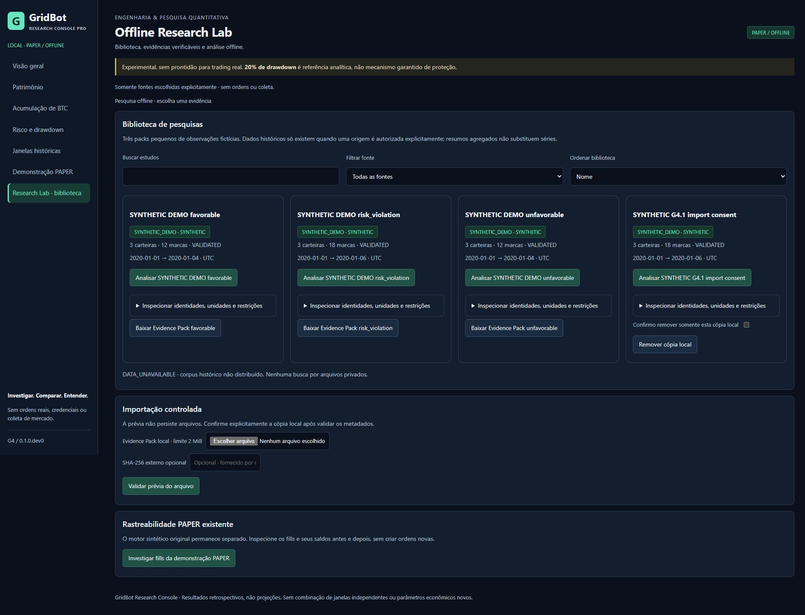

# G4.1 — Research Lab Hardening & Global Quality Closure

Execução local em 24/10/2026. Campanha global nova concluída;
nenhum resultado global antigo foi usado para certificar a G4.1.

## 1. Resumo executivo

Endurecimento de contêineres ZIP, autorização independente de exportação,
serialização de gravações e estados assíncronos da interface. Contratos econômicos
e módulos financeiros nativos preservados. Não há estratégia nova, otimização,
backtest histórico, Binance, LIVE/Testnet, coleta, telemetria ou publicação.

## 2. Branch, HEAD e baseline

Base G4: `cc7f140be46838feccc1f543c3a64f919588aa8f`.
Branch: `fix/g4-research-lab-hardening`.
Código congelado para a campanha: `27a44458c12a9384334f857febc26b355567f73a`.
Main publicada/origin/main em `88390ac`; referência local main antiga em `a28e6f3`,
sem movimentação. Os dois relatórios locais antigos não rastreados são preservados.
Nenhum reset/clean, push, PR remoto, merge, tag, release, Actions ou G5.

## 3. Evidência G4 e limites de reaproveitamento

G4 arquivou 584 Python PASS + um skip Windows e 26 JS, cobertura dirigida
95,99%/97,25% e global PENDING. Seus recibos de performance e hashes foram
conferidos. Os valores 225,73 → 84,83 ms e 92,67 ms são medições anteriores,
não resultados atuais. A G3.1 global 96,53% também permanece histórica.
O inventário G4 continha 3.567 nodeids; não se somam 584 como se fossem todos novos.

## 4. Arquitetura e fronteiras de confiança

```mermaid
flowchart LR
    U["Bytes não confiáveis escolhidos pelo usuário"] --> Z["Contêiner, limites, CRC, JSON e schema"]
    Z --> V["Snapshot validado e identidades"]
    V --> C["Confirmação de persistência"]
    C --> S["Staging + fsync + publicação atômica"]
    S --> A["Revalidação e análise Fraction"]
    A --> I["Consulta local, tabelas e gráficos"]
    I --> O["Autorização do operador fora do pack"]
    O --> E["Exportação conforme escopo e restrição"]
```



Validade estrutural não autentica a origem. Persistir não concede direitos de
redistribuição. A análise não executa código do pack. Leitura local autorizada
não constitui isolamento contra o próprio operador ou outros processos locais
com seus privilégios. Não se adicionou framework, banco ou dependência de runtime.

## 5. Threat model

Ativos: arquivos do usuário, dados privados, resultados, identidades, biblioteca,
memória/CPU, interface, exports e diretórios protegidos. Agente adversarial
principal: produtor de um arquivo arbitrário e página externa tentando usar
localhost. Adversário com controle concorrente do namespace de arquivos ou do
processo Python do operador não é contido como se houvesse sandbox de sistema.

| Entrada/ameaça | Fronteira e proteção | Limite |
| --- | --- | --- |
| ZIP slip, drive/UNC/ADS/reservados, aliases Unicode | dois nomes internos exatos; nenhuma extração; nomes opacos SHA no disco | não há caminhos de entrada HTTP |
| Bomb, tamanho falso, conteúdo oculto | saída DEFLATE limitada, EOF/tails/CRC/tamanho real e limites totais | limites de dados não são uma garantia universal de RSS/latência |
| JSON profundo/largo, números e strings extremos | orçamento pré-parse, schema estrito e aritmética limitada | conteúdo declarado pode continuar economicamente falso |
| Links/reparse/lock hardlink | lstat por componentes; lock regular de uma ligação, tamanho controlado | corridas maliciosas de diretório por usuário privilegiado não são garantidas |
| Import simultâneo/interrompido | RLock por objeto + lock OS entre processos + temporário exclusivo + fsync/replace | não se promete durabilidade contra toda falha de energia/hardware |
| Licença/source_kind falsos | bytes exatos dos fixtures próprios ou consentimento independente por SHA/sessão | não é análise jurídica ou assinatura de autoria |
| XSS/CSV/SVG/HTML | textContent, escape, CSP, whitelist, neutralização e escopo de export | usuário autorizado ainda pode salvar consulta/capturas |
| CSRF/rebinding/framing | bind IPv4 loopback, Host/Origin/sessão e cabeçalhos únicos | não é um serviço multiusuário ou defesa contra malware local |

## 6. Defeitos comprovados e severidade

| Defeito na G4 | Reprodução | Correção | Severidade |
| --- | --- | --- | --- |
| ZIP aceitava prefixo válido apesar de inflação subdeclarada ou bytes extras no DEFLATE | dois testes inicialmente DID NOT RAISE; payload com CRC do prefixo e cabeçalhos plausíveis | decoder limitado sobre o trecho comprimido real, EOF/tails/tamanho/CRC | P2: integridade; não se alegou OOM comprovado |
| PUBLIC/source_kind autodeclarados liberavam exportação de um pack externo | teste inicialmente DID NOT RAISE | autorização do operador separada dos metadados e vinculada ao SHA | P2: governança/privacidade das funções de export |
| Duas instâncias podiam ultrapassar quota | versão Git G4 isolada, quota 1, duas cópias publicadas como VALIDATED | lock entre processos, revalidação e quota dentro da região crítica | P2: consistência/disponibilidade local |

Cabeçalhos de escrita duplicados e retornos assíncronos adicionais receberam
defesa e regressões. Não se demonstrou exploração remota desses caminhos nem
defeito em fórmulas financeiras congeladas. Hardlink do novo arquivo de lock foi
recusado em teste, sem modificar o arquivo externo da fixture.

## 7. ZIP e bytes consumidos

2 MiB compactados, 6 MiB totais descompactados, duas entradas fixas, razão ≤100,
manifesto ≤16 KiB, 60 contas/10.000 marcas. O leitor G4 usava ZipExtFile, que pode
devolver somente o prefixo declarado e ignorar saída adicional. A G4.1 verifica
o DEFLATE diretamente com limite `declared_size + 1`, sempre dentro do orçamento
validado; exige EOF sem unused/unconsumed data e CRC/tamanho efetivos. STORED é
conferido pelos bytes reais. Não existe execução ou extração de payload.
Bomb de inflação real maior que 8 MiB com tamanho declarado menor é recusada.

## 8. JSON, metadados e identidade

UTF-8 estrito, chaves únicas, profundidade 32 e orçamento de 250.000 itens,
campos/versão/unidades/UTC/quantidades restritos. Nomes internos e identificadores
não são normalizados para um caminho: devem corresponder exatamente ao contrato.
Mudar ordem ZIP pode preservar a matemática, mas muda o hash do contêiner e a
identidade para replay. SHA de origem independente pode conferir os bytes;
hashes autodeclarados não autenticam a fonte. O schema continua v1 e os três
fixtures válidos mantêm seus hashes.

## 9. Caminhos e proteção do usuário

Nenhum caminho HTTP é aceito. Raiz absoluta explicitamente indicada pelo operador,
marcador de propriedade, nomes SHA e rejeição de UNC, ADS, nomes reservados,
aliases com ponto/espaço final, symlinks e reparse points. Teste real de junction
Windows e hardlink usou somente fixture própria. Não houve varredura geral ou
acesso corporativo. O original é somente leitura para verificações de preservação.

## 10. Persistência e recuperação

Confirmação e token válidos são exigidos antes de criar metadado de lock. Falhas
simuladas de escrita parcial, flush, fsync/ENOSPC e replace preservaram os estudos
anteriores e permitiram retry. Encerramento real com os._exit após escrita parcial
deixou apenas staging: o restart não o apresentou como estudo e um novo import
completo funcionou. Órfãos não são apagados automaticamente. A origem selecionada
permaneceu igual. Replace atômico não é garantia contra toda perda física de disco.

## 11. Concorrência

RLock cobre pending, cache, grants e operações do mesmo objeto. Lock de arquivo
não bloqueante do OS serializa publicações/remoções entre instâncias e processos.
Uma operação concorrente recebe LIBRARY_BUSY para retry; não há fila infinita.
O kernel libera o lock após crash, sem depender de PID/arquivo sentinela obsoleto.
Testes: quota entre instâncias, processo concorrente morto, consulta durante
staging, duplo confirmar com uma cópia, tamper/corrupção/restart e falhas de I/O.
HTTP de cada instância continua sequencial; isso não cria escalabilidade multiusuário.

## 12. Permissões de redistribuição

Somente os bytes completos dos três fixtures do projeto recebem autorização
automática. Alegar SYNTHETIC_DEMO/PUBLIC/licença conhecida não é suficiente.
Grants separados: OWN_DATA, VERIFIED_PUBLIC_LICENSE ou RIGHTSHOLDER_PERMISSION,
confirmação explícita e escopo DERIVED_ONLY/RAW_AND_DERIVED. O operador deve
verificar a base fora do pack. Estado fica em memória por SHA/processo; reiniciar
exige nova revisão. RESTRICTED não é superado; AGGREGATES_ONLY não libera raw.

## 13. Exports e canais alternativos

Rotas source/export conferem o grant no servidor, além da restrição declarada;
query ou metadados não concedem autorização. DERIVED_ONLY exclui pack fonte,
curvas/episódios e valores exatos de série; SVG fica negado. Manifesto e relatório
também exigem autorização na UI. JSON/CSV/HTML são projeções controladas, com
checksums. O adaptador histórico anterior conserva negação de JSON bruto e CSV
resumido mediante revisão explícita.

A API autenticada de consulta fornece as marcas necessárias à inspeção local.
Não é uma barreira DRM contra o operador, que já possui o arquivo e pode salvar
respostas/capturas ou copiar o disco. A política governa os exports da aplicação,
não afirma impedir toda recópia por usuário local autorizado. Essa fronteira é
explícita; páginas externas não recebem dados por CORS ou grants automáticos.

## 14. Integridade, proveniência e autenticidade

Integridade = bytes correspondentes ao hash esperado. Proveniência = declaração
do produtor. Autenticidade exigiria identidade/chave confiável ou outro processo
verificável, não implementado aqui. Reprodutibilidade = reconstruir a mesma
análise dos mesmos dados/código/seleção. Consentimento do operador não transforma
uma origem falsa em verdadeira nem constitui verificação jurídica automática.

## 15. Matemática e custos

Fraction para NAV=C+B×P, retorno, BTC físico/equivalente, exposição e comparação.
Sem double-count de reservas ou segunda subtração de fees já nos saldos. Fees
do pack são acumulados declarados em USDT, não ledger autenticado multimoeda.
Nada foi inventado para custos ausentes; fluxos externos/outros ativos/passivos
continuam fora de v1. Métricas do módulo analytics não foram alteradas.

Reconciliação independente do exemplo fictício risk_violation: capital inicial
100 USDT, preço inicial 10 e final 6 USDT/BTC, nenhuma taxa nesta fixture:

| Conta | Caixa final USDT | BTC físico | NAV final USDT | BTC equivalente | Retorno | DD máximo |
| --- | ---: | ---: | ---: | ---: | ---: | ---: |
| BTC_HOLD | 0 | 10 | 60 | 10 | −40% | 2/5 |
| CASH | 100 | 0 | 100 | 50/3 | 0% | 0 |
| MIX | 50 | 5 | 80 | 40/3 | −20% | 1/5 |

Por exemplo, MIX: `50 + 5×6 = 80`; BTC equivalente `80/6 = 40/3`;
retorno `(80−100)/100 = −1/5`. Essa quantidade equivalente não é BTC físico.
O pico anterior 100 e o vale 80 atingem exatamente 20%, sem violação estrita.
Os fills da demonstração PAPER também foram reconciliados em Fraction durante
as duas instalações, com saldos antes/depois e sinal de BUY/SELL independentes.

## 16. Pareto e propriedades metamórficas

Oráculo vetorial independente, dois/três objetivos, magnitudes de DD positivas
minimizadas, valores abstratos negativos/zero, empates, permutação, grupos e dados
faltantes. Sem score de unidades misturadas. Oráculo quadrático de DD independente
e metamorfismo por escala positiva em 50 casos cada, além dos 60+60 anteriores.
Reordenar contas preserva métricas/Pareto; comparação de CASH consigo mesma dá
diferenças absolutas nulas. Razões com denominador zero continuam indisponíveis,
inclusive a comparação relativa BTC=0 contra BTC=0. Valores fora do contrato
financeiro são recusados pelo parser.

## 17. Drawdown e evidência insuficiente

Convenção anterior preservada: pico observado, vale mais antigo empatado,
recuperação ≥pico; gaps censuram e reiniciam o segmento. Exatamente 1/5 atinge a
referência sem ultrapassá-la; violação exige valor maior. Série diária não prova
risco intradiário. Razões indefinidas, zero e série unitária não geram números
artificiais; anualização continua indisponível por ausência de convenção v1.

## 18. Replay e processos independentes

Identidades de pack, código LF/CRLF normalizado, seleção, unidades e resultado.
Manifesto baixado no navegador reproduziu EQUIVALENT após reiniciar o servidor,
com mesmo estudo persistido e sem reutilizar grant. Não executa backtests. Dados
são autocontidos; o código compatível e ambiente Python são requisitos explícitos.
G4/G4.1 podem divergir em identidade de código, sem modificar resultados antigos.

## 19. Segurança web local

Bind 127.0.0.1, Host/Origin/cookie únicos, SameSite/HttpOnly, custom header para
POST, Content-Type/Length únicos, TE recusado e limites antes da leitura.
Erros com códigos fixos, sem paths/payloads/tracebacks. Dados viram textContent;
HTML/SVG escapados; CSP e nosniff. Sem API privada, wallet, credenciais ou telemetria.
Outras aplicações locais com privilégios do operador não são isoladas por esse
cookie: é proteção web/origem, não autenticação contra malware no mesmo usuário.

## 20. Interface e cancelamento

AbortController e revisões invalidam consultas antigas, downloads e retornos de
confirmar/remover/replay/PAPER. Isso não é rollback de um commit já concluído no
servidor: após interrupção, consulte a biblioteca. Importações são idempotentes
por bytes; seleção recente não recebe resultado de uma ação antiga. Botões de
export e SVG refletem grant separado, sem confiar no source_kind autodeclarado.

## 21. Inventário e campanha global

Inventário atual: **3.612 nodeids únicos**, 132 propriedades/máquinas reconhecidas,
120 módulos de produção (104 nativos + 16 do console). Nenhum nodeid anterior
foi retirado. Perfil Hypothesis ci original, até 300 exemplos, sem redução.
Uma nova coleta isolada da própria árvore Git G4 confirmou 3.567 nodeids;
a diferença de conjuntos é exatamente +45 e zero removidos. Inventário de
marcadores não encontrou xfail; os dois skips efetivos foram reconciliados pelas fases.
Campanhas disjuntas em no máximo dois processos, prioridade abaixo do normal,
budget 5.400 s por grupo e limite 1.800 s por segmento. Prazos foram escolhidos
com base em medições antigas que incluem uma máquina de ~1.099 s, não para
confundir teste caro com travamento. Os dados antigos não entram no gate novo.

**3.610 PASS + dois SKIP**, 3.612 nodeids únicos, zero FAIL/INCOMPLETE/xfail.
273 segmentos, duas campanhas com exit 0, união completa e disjunta. Tempo de
parede do par: 3.686,31 s (61,44 min); soma de tempos de segmentos/CPU é registrada
separadamente, não confundida com esse tempo concorrente. HEAD e todos os hashes
congelados foram iguais antes/depois. Nenhum segmento sofreu timeout.

Skips: teste POSIX chmod 600 e criação de symlink indisponível nesta conta
Windows, ambos anteriores. A junction Windows nova foi efetivamente testada.
A máquina de duas gerações concluiu em 664,25 s nesta campanha; o tempo histórico
~1.099 s serviu apenas ao planejamento. Não se atribui essa diferença a otimização.
Fases, exit codes, durações, source/config/ambiente e hashes estão no manifesto.

## 22. Cobertura global

Threshold 85% e branches preservados. Configuração agora inclui explicitamente
gridbot e research_console; o consolidador exige os 120 arquivos efetivamente
medidos, sem fontes estrangeiras. A configuração anterior media apenas gridbot,
portanto não encerrava a pendência G4 do console. Bancos completos e compatíveis
foram combinados por Coverage.combine, sem média de percentuais ou dados G3/G4.
**96,47583040777748%**, threshold original **85%**, exit 0 e 120 arquivos no
denominador. Linhas: 11.481/11.784 (97,43%); branches: 2.809/3.028 (92,77%);
percentual combinado: (11.481+2.809)/(11.784+3.028). Há 303 linhas e 219 branches
não cobertos, 197 branches parciais e 85 linhas excluídas pela configuração
visível. O relatório completo preserva caminhos relativos e lacunas por arquivo.
Cobertura alta não significa todas as linhas testadas nem segurança universal.

Por soma de linhas/branches em cada conjunto: núcleo 96,53%; console 96,08%.
No Lab, packs/exports/permissions/fixtures têm 100%; analytics 98,73%; library
96,08%; storage 90,91%; adaptador HTTP 90,82%. Storage 63/65/75 são o ramo
POSIX não executado no Windows. Lacunas do adaptador incluem erros/rotas de
fallback; a rota library normal é tratada pelo servidor externo ao adaptador.
Library 275 é eviction do cache; analytics 122 é o salto de um intervalo ausente.
Não se adicionaram testes cosméticos para alterar estes percentuais.

Oráculos adicionais finitos fora do banco de coverage confirmaram NAV/retorno
por endpoints com gap, risco/exposição sem inferência através do gap, razões
indefinidas com NAV zero, eviction/recomputação LRU e mensagem fixa de I/O sem
ecoar entrada. Não contam como novos nodeids nem aumentam a cobertura global.
Esses caminhos continuam identificados como lacunas da campanha instrumentada.

O denominador principal identifica os dois pacotes gridbot/research_console;
não inclui testes, ferramentas de auditoria ou os três módulos de demonstração
empacotados em examples. Estes últimos receberam uma medição suplementar nova,
separada: **87,37%**, com branches, 85% preservados, três regressões existentes
aprovadas e os dois entrypoints sintéticos exercitados. Não se faz média desse
percentual com o global. As exclusões TYPE_CHECKING/NotImplementedError/ellipsis
e os nove pragmas nativos existentes permanecem visíveis e inalterados; não há
novo pragma, omit ou skip adicionado para elevar cobertura.

## 23. Testes dirigidos e falhas de desenvolvimento

Três repros iniciais falharam como esperado antes das correções; nova execução
passou. Quota G4 reproduzida em versão Git isolada: duas cópias com limite 1.
37 casos de hardening passaram, incluindo crash real. Outra execução dirigida
contabilizou 192 PASS antes dos três últimos casos de crash/concorrência, também
aprovados separadamente; não se somam reexecuções como casos distintos.
Ruff/format/Mypy strict foram aprovados antes do congelamento; 278 arquivos Mypy.
26 testes JS anteriores continuam aprovados. Um mock antigo foi adaptado de
is_symlink para lstat; não se retirou o teste. Erros de tipagem/formatação e
encoding em strings de teste foram corrigidos e as falhas ficaram registradas.

Reprodução dirigida no checkout público, com dependências fixadas instaladas:

```powershell
python -m pytest tests/console/test_lab_hardening.py tests/console/test_lab_http.py -q
node --test tests/console/chart_state.test.cjs tests/console/lab_state.test.cjs
python -m ruff check .
python -m ruff format --check .
python -m mypy
```

Para a campanha completa, usar os comandos tools.quality_gate inventory/run e
tools.quality_coverage bundle/combine, sempre com pastas de evidência novas.
As duas listas disjuntas de nodeids e as fases completas ficam no manifesto
G4_1_EXECUTION_MANIFEST.json.gz; elas permitem reconstruir os arquivos
pending_nodeids sem alterar o perfil ci ou o threshold. Os logs completos ficam
locais, com seus hashes no manifesto. Dados de execuções anteriores não entram
nos bancos novos.

## 24. Navegador real

Instância própria em porta alternativa, sem atuar em serviços do usuário.
Prévia, confirmação, duplicata com uma cópia, export negado por padrão, autorização
de derivados sem raw/SVG e ampliação explícita foram exercitados. Restart manteve
o estudo e perdeu o grant. ZIP derivado foi baixado e verificado independentemente:
checksums corretos, sem fonte/curvas/episódios. Replay por arquivo em novo processo
foi equivalente. PAPER nativo foi executado; duas abas mantiveram seleções distintas.
Arquivo inválido, >2 MiB e seleção vazia foram recusados com mensagens claras.
Teste de atraso de 1 s + mudança para Patrimônio confirmou descarte do retorno.

Capturas nativas full-page em 1920×1080, 1366×768, 768×1024 e 390×844 CSS;
scrollWidth=clientWidth em todas. Inspeção visual explícita desktop/mobile, DOM
e capturas nas demais larguras; não se declara leitor de tela ou todos os browsers.
Teclado consultou marca real e o console de erros da aba estava vazio.
Viewport foi restaurado, abas e instâncias próprias encerradas. Capturas guardadas
na auditoria local; nenhuma imagem gerada foi apresentada como screenshot.



## 25. Performance

Benchmark finito após encerrar as campanhas: Ryzen 5 5600X, seis cores/12
lógicos, 34.259.087.360 bytes físicos, Windows/Python 3.13.16. G4 cc7f140 em
snapshot Git isolado, seguida da G4.1, processos separados, mesmo ambiente e
GC padrão. Outras cargas do host não foram controladas. Inputs fora do relógio,
sete repetições por fase; cold adapter tem três objetos Library novos, não três
cold boots de Python. Memória foi instrumentada separadamente. Quatro hashes
de input e quatro hashes da análise completa coincidiram exatamente. Export
usa autorização RAW_AND_DERIVED explícita para estes fixtures próprios; a
identidade de código no manifesto exportado difere legitimamente entre versões.

| Marcas totais | Validação G4.1 ms | Análise G4.1 ms | Consulta aquecida G4 ms | Consulta aquecida G4.1 ms, mediana [mín–máx] | Export G4.1 ms |
| ---: | ---: | ---: | ---: | ---: | ---: |
| 30 | 0.93 | 1.34 | 1.64 | 1.59 [1.57–1.64] | 2.50 |
| 300 | 6.44 | 9.03 | 9.34 | 9.23 [9.06–9.63] | 12.70 |
| 3000 | 65.38 | 85.52 | 90.61 | 86.76 [85.62–97.97] | 112.62 |
| 9999 | 205.79 | 285.41 | 285.41 | 285.77 [284.29–293.47] | 375.16 |

Em 9.999 marcas, parse 49,32 ms, SHA 0,015 ms, episódios de uma conta 45,51 ms,
replay 298,49 ms e adapter com objeto frio 583,90 ms. Cold objeto não equivale
a cold processo/OS. As instalações mediram startup HTTP em experimento separado
(~0,52 s, com campanhas ativas). Nenhum ganho percentual é inferido destas
amostras; variabilidade/carga e ordem limitam comparações. A consulta aquecida
continua revalidando bytes, exatamente uma chamada read_pack no perfil, sem
repetição redundante. Cache: quatro entradas e 29 hits no ensaio.

Catalogar três fixtures em memória: 2,10 ms; 35 packs pequenos distintos em
memória: 22,17 ms, sem medir disco de uma biblioteca máxima. Pareto abstrato
com todos os vetores não dominados: 3/15/30/60 contas, 0,087/2,88/12,06/49,20 ms.
O custo é quadrático nas contas e linear nos objetivos, limitado a 60; os fluxos
de marcas são aproximadamente lineares no tamanho testado. Hashing não dominou;
validação exata/serialização/cópias continuam relevantes. O servidor HTTP é
sequencial, e oito leituras em quatro clientes verificaram a fila nas instalações;
isso não certifica throughput multiusuário nem a quota máxima com packs grandes.

Picos Python incrementais únicos em 9.999 marcas: validação 4.360.620 bytes e
análise 3.295.326 bytes, com input existente fora de tracemalloc. Pico working set
do processo inteiro: 58.376.192 bytes, incluindo imports, geração e instrumentos,
não um pico isolado por chamada. O baseline foi 57.970.688 bytes de working set;
não se infere uma mudança de uso de memória a partir de duas execuções.
Sem substituição de Fraction por float, remoção de validação ou limite ampliado.
Não há SLA, meta inventada ou extrapolação de capacidade.

A interface foi adicionalmente exercitada com 9.999 marcas fictícias em três
contas, 1.666 episódios e 2.117 elementos DOM. Seleção do último episódio
correspondeu aos índices 3330–3332, com recuperação exata e magnitude 1/10.
Sete ações Aplicar seleção: desktop 1366×768, mediana 495 ms (466–946);
mobile 390×844, mediana 475 ms (457–519). Isso mede ação por automação até o
controle de análise voltar habilitado, incluindo ponte/HTTP/JS/DOM, não pintura
GPU. As duas campanhas de coverage estavam ativas: não é comparação com host
ocioso nem com G4. Não houve overflow no documento, warning ou erro de browser.
Capturas reais foram salvas; o servidor e a aba próprios foram encerrados.

## 26. Empacotamento e primeiro uso

Wheel, instalação editável e launcher Windows passaram em ambientes novos,
fora da árvore de desenvolvimento, em caminhos próprios com espaços/Unicode.
O wheel final de validação possui 142 membros: 104 módulos nativos idênticos,
três packs e todos os assets, além dos dois guias essenciais force-included.
CLI/entrypoint, biblioteca, importação com confirmação, exports/checksums,
replay em processo reiniciado, expiração do grant e fills PAPER passaram.
Hooks de auditoria negavam acesso ao original/corporativo e conexões externas;
nenhuma tentativa foi registrada. Pip check passou nos dois ambientes.
O launcher encaminhou porta própria e foi encerrado com sua árvore de processos.
Linux/macOS não foram testados. O artefato final foi reconstruído após atualizar
README e os dois guias, reinstalado no venv limpo e validado novamente por HTTP.
Todo código/asset/config corresponde ao código congelado, normalizando somente
LF/CRLF; guias no ZIP e README no METADATA foram comparados à árvore final.
SHA-256 do wheel: `470ca468bf5770b5af99335bb805dc20f6a2e6a107ed328d5341608de0f5f47f`.
Os recibos do wheel inicial permanecem arquivados; ele não é o artefato final.

## 27. Segurança Git e dependências

Varredura preliminar: 371 arquivos, oito payloads descompactados, nenhum
secret ou marcador pessoal. Nova consulta OSV oficial em 39 pins distintos,
incluindo runtime/dev/build/pip/hooks, sem advisory correspondente retornado.
Isso não garante ausência de vulnerabilidade desconhecida ou futura. Scans
finais incluem os manifestos novos, árvore, conteúdo descompactado e histórico
ainda não publicado. Ruff/format (312 arquivos), Mypy strict (278), Prettier,
26 JS e pre-commit --all-files foram aprovados, com exit 0. Git diff --check
também passou. Varredura final: 373 arquivos e nove payloads descompactados,
sem secrets, warnings ou marcadores pessoais. O histórico não publicado de
código G4/G4.1 foi examinado até 27a4445, sem findings; o commit documental é
verificado pela árvore/staged e o selo local registra a checagem histórica
posterior ao commit. Não se embute um hash de scan do próprio relatório no
relatório, evitando uma alegação autorreferente impossível.
Configuração de Gitleaks sem exclusões de caminho adicionais e com inline
allow-comments ignorados; sem relaxar regras para forçar PASS.
Hooks dos dois commits de código passaram. Relatórios anteriores não são reescritos
nem descartados. Nenhum arquivo temporário de execução é adicionado indiscriminadamente.

## 28. Arquivos e commits

`340bcbb`: ZIP, grants independentes, storage/locks, proteção de caminhos, testes,
escopo de coverage e recursos de ajuda no wheel.
`27a4445`: retorno assíncrono/cancelamento e controles de autorização na interface.
Documentação, captura e evidências constituem o commit documental de fechamento,
posterior aos testes. Não houve commit durante a campanha global. O HEAD final
pode incluir esse commit sem ser rotulado como execução de código diferente: o
diff posterior a 27a4445 é documental, e os hashes executáveis continuam iguais.
O SHA final é fornecido pela entrega/Git, evitando autorreferência ao próprio commit.

Arquivos funcionais alterados: pyproject.toml (coverage/recursos), lab/packs,
permissions, storage, library, exports, http; server.py; static/lab.js; tools/quality_coverage.py.
Regressões: tests/console/test_lab.py, test_lab_hardening.py e test_lab_http.py.
Documentação: README, dois guias G4, este relatório, changelog/PR local, sumário
JSON, manifesto gzip e captura. Nenhum src/gridbot ou parâmetro financeiro muda.

Evidências: [sumário](G4_1_VALIDATION_SUMMARY.json) e
[manifesto completo](G4_1_EXECUTION_MANIFEST.json.gz). O último contém 3.612
nodeids, fases, perfis/config, 273 recibos de segmento, lacunas por arquivo e
amostras de benchmark. Logs brutos e bancos SQLite/HTML ficam locais, sem
publicar o inventário privado do original ou paths pessoais.

## 29. Preservação financeira e original

Diff de src/gridbot é vazio; os 104 blobs coincidem com PUBLIC_SOURCE_MANIFEST.
Rehash final em 24/10/2026 17:43 UTC: 1.665 arquivos preservados, zero alterados,
HEAD original 528f8c40ce6f74f9440444b2e652c56fae222fb2, tracked limpo, sem remote
e seis históricos não rastreados preservados. SHA-256 V2 FINAL:
`44e9639554d01c13e2e0648613e7904a6f1649ca934b00b3821021aa28582249`.
Os dois relatórios antigos locais também mantêm seus hashes e ficam não
rastreados. Nenhuma escrita/teste foi dirigido ao original.
PAPER é somente a demonstração sintética existente; não há nova política financeira.

## 30. Limitações e riscos remanescentes

Direitos/proveniência declarados com revisão humana, sem assinatura ou validação
jurídica; consulta local não é DRM; fees não autenticadas por ledger do pack;
risco amostrado sem garantia de proteção; HTTP sequencial; namespace local
malicioso/energia/hardware não são completamente contidos; sem teste Linux/macOS,
leitor de tela ou carga multiusuário máxima. Percentual alto não prova correção
ou segurança universal; lacunas e escopo de cobertura estão explicitados acima.

Segunda leitura crítica do parser, storage, grants, replay, fronteiras HTTP e
empacotamento foi realizada pelo mesmo executor, com oráculos e reproduções
separados. Não equivale a revisão humana independente ou certificação externa.
Não foi identificado outro defeito financeiro que justificasse alterar os
contratos congelados. O gráfico de milhares de oscilações se torna visualmente
denso; seleção de episódio e tabela exata continuam necessárias à investigação.

## 31. Recomendação e gates

Recomendo a candidata local para revisão do orquestrador, limitada ao laboratório
offline/PAPER e às plataformas efetivamente testadas. Os três defeitos P2
comprovados receberam correções e regressões; não há bloqueio crítico conhecido
no escopo validado. Cobertura não é prova universal, direitos continuam sujeitos
a revisão humana e os limites desta auditoria permanecem parte do parecer.

```text
G4_1_HARDENING_PASS
G4_1_GLOBAL_TESTS_PASS
G4_1_GLOBAL_COVERAGE_PASS
G4_RELEASE_CANDIDATE_READY_FOR_REVIEW
FINANCIAL_RESULTS_PRESERVED
ORIGINAL_GRIDBOT_PRESERVED
FROZEN_V2_PRESERVED
PAPER_DEMO_DETERMINISTIC
REAL_TRADING_DISABLED
GITHUB_PUSH_NOT_PERFORMED
```

Não há autorização de publicação nesta fase. Não houve push, PR remoto, merge,
tag, release, ativação de Actions ou início de G5. Main publicada e referências
locais anteriores preservadas. Aguarda revisão do ChatGPT orquestrador.
