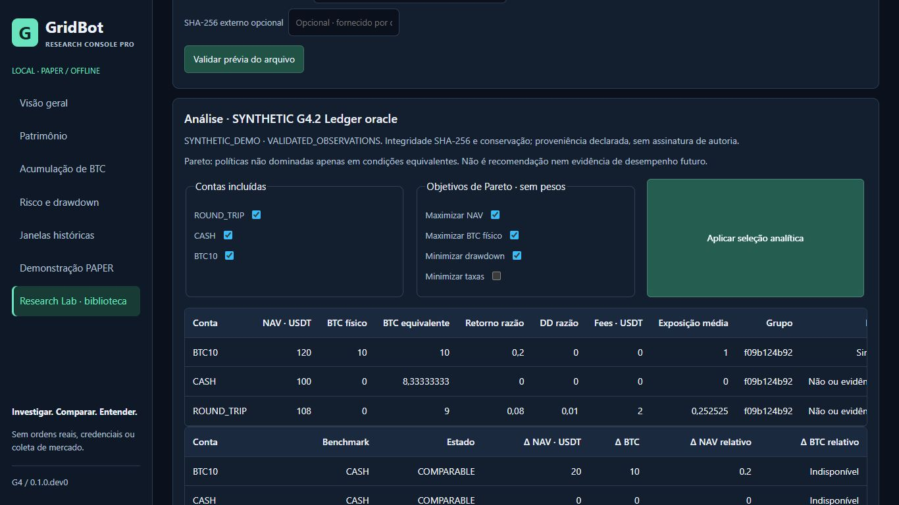

# G4.2 — Research Lab release integration and publication audit

Data: 2026-10-24. Escopo: candidata **local**, PAPER / OFFLINE. Esta missão não
autoriza publicação. Nenhum push, PR remoto, merge, tag, release ou ativação de
Actions foi realizado. Nenhuma estratégia, resultado econômico ou parâmetro foi alterado.

## 1. Resumo executivo

**G4_2_RELEASE_INTEGRATION_PASS — PUBLICATION_CANDIDATE_READY**, para revisão e
autorização posterior do orquestrador. A prontidão é de uma candidata experimental
de pesquisa offline. Não significa trading pronto, CI remoto aprovado, licença
de qualquer pack externo verificada ou limite de perdas garantido.

Os três P2 corrigidos na G4.1 resistiram à revisão independente e aos adversários
novos no wheel instalado. Não foi comprovado um novo defeito de produção que
exigisse alterar Python, JavaScript, testes ou configuração. A correção G4.2 foi
documental: indicar a branch candidata correta e distinguir instalação local da
main ainda publicada, além do escopo dos guias incluídos no wheel.

## 2. Identidade do código

| Referência | Identidade |
| --- | --- |
| Repositório | `SiqueiraBr15/bitcoin-gridbot-research` |
| Branch candidata local | `release/g4-offline-research-lab` |
| Base G4.1 recebida | `80b42cc3c1584781d99b481758ea4bba99f92494` |
| Código executado na campanha global G4.1 | `27a44458c12a9384334f857febc26b355567f73a` |
| Checkout exportado para as instalações G4.2 | `548aaa8fa0761ce57a36e47950b7dd3f55b0026f` |
| Main remota consultada anonimamente | `88390ac0b3726c50b548e5087acfa39982d76342` |
| Main local antiga, preservada | `a28e6f35b7b0acb42cee6dc97959cdf65f6022b0` |

Após `548aaa8`, o fechamento acrescenta exclusivamente esta auditoria, PR local,
checklist, inventário e uma captura real. O HEAD de entrega é o commit que contém
esses documentos; obtenha seu identificador completo com `git rev-parse HEAD`.
Ele é informado também na entrega e no checkpoint local externo ao Git. O
manifesto não tenta conter o próprio hash nem prever o hash do commit que o contém.

## 3. Baseline e evidências consultadas

Leitura integral dos relatórios G4/G4.1, seus changelogs, guias do Lab e contrato
Evidence Pack v1. O resumo G4.1 e o manifesto de execução compactado foram
processados integralmente, incluindo referências, fases, resultados e cobertura.
Revisão de código e testes pertinentes de packs, análise, armazenamento,
permissões, exportação, HTTP, servidor e interface. Documentos anteriores foram
preservados, inclusive os dois relatórios G3.3/G3.4 não rastreados.

Há um único worktree público. A main remota é ancestral da G4.1; a candidata
parte da G4.1 recebida. Não foi necessário merge, reset, rebase ou duplicar commits.
O remote HTTPS existente permaneceu intacto. Nenhuma credencial foi consultada.

## 4. Reconciliação dos testes globais

**Reuso auditado, não nova execução global de pytest.** Nova coleta encontrou
3.612 nodeids únicos, exatamente o conjunto congelado. Foram conferidos os 273
segmentos G4.1, recibos de processo, saída zero, SHA-256 dos logs, registros de
fases e bancos SQLite. Setup/call/teardown e skips foram reconciliados por nodeid,
sem omissões, sobreposições, falhas ou incompletos.

Resultado global preservado: **3.610 PASS + 2 SKIP**. Skips existentes:
`test_env_file_posix_permissions_restricted` (chmod 600 não aplicável no Windows)
e `test_real_symlink_outside_archive_is_refused` (conta sem suporte à criação
de symlink nesse teste). O teste de junction Windows do Lab passou nesta fase.

Nova execução dirigida: **190 PASS**, zero skips/falhas, em **32,21 s**:
`tests/console/test_lab.py`, `test_lab_hardening.py`, `test_lab_http.py`.
Inclui Hypothesis, oráculos quadráticos de risco/Pareto, falhas de persistência,
crash real e concorrência. Os adversários externos ao pytest não são somados à
contagem global. Node executou novamente os **26 testes JavaScript**, todos PASS.

## 5. Cobertura e equivalência

Os **295 arquivos** congelados de fontes, testes, assets e configuração mantêm
SHA-256 idêntico. A identidade das dependências e configuração da coleta nova
também coincide. Os bancos de cobertura G4.1 foram lidos e recombinados em destino
novo, sem modificar as evidências anteriores. Arcos presentes; universo exato de
**120 módulos**, sendo 104 nativos e 16 do console; nenhum módulo estrangeiro.

| Medida global revalidada | Resultado |
| --- | ---: |
| Statements cobertos / medidos | 11.481 / 11.784 |
| Branches cobertos / medidos | 2.809 / 3.028 |
| Cobertura combinada de statements e branches | **96,47583040777748%** |
| Linhas faltantes / branches faltantes | 303 / 219 |
| Linhas excluídas / branches parciais | 85 / 197 |
| Threshold original, inalterado | **85%** |

Arquivos e totais recombinados coincidem com o manifesto público G4.1. Exemplos:
**87,36842105263158%**, medição G4.1 separada, sem média com o núcleo; não foi
executada nova campanha de exemplos. Não se atribui uma execução global ao HEAD
documental atual: o vínculo é a equivalência verificada com o código executado.

## 6. Três P2 e regressões

| P2 G4.1 | Revisão e reprodução G4.2 | Resultado |
| --- | --- | --- |
| Bytes ZIP não manifestados | ZIPs construídos manualmente com `struct`, sem o writer de produção como oráculo | Conteúdo excedente recusado |
| Pack concedendo direitos a si próprio | PUBLIC/SYNTHETIC importado, sem grant; tentativas HTTP/API e `reviewed=1` | Exportação recusada no backend |
| Corrida na quota/persistência | Dois processos reais, 31 cópias prévias e limite real 32 | Uma importação; outra ocupada; 32 finais |

Regressões públicas relevantes em `test_lab_hardening.py`:
`test_actual_inflated_bytes_not_only_zip_declared_size`,
`test_self_declared_public_pack_does_not_authorize_export`,
`test_independent_export_consent_all_formats_and_restart`,
`test_multiple_instances_cannot_race_quota`,
`test_lock_excludes_other_process_and_releases_after_crash`,
`test_failed_commit_preserves_existing_study_and_retry` e
`test_real_process_exit_after_partial_write_and_safe_retry`.
Foram efetivamente executadas dentro dos 190 testes, não apenas inspecionadas.

## 7. Segurança dos packs

Controles STORED/DEFLATE válidos aceitos. Recusados: cauda dentro do stream
compactado, inflação real maior que a declarada, sobra STORED, duplicata,
truncamento e terceira entrada. Leitor exige duas entradas fixas, layout ZIP
restrito, identidade do manifesto, SHA-256, CRC, comprimento e EOF/consumo integral;
não extrai caminhos. Verificações existentes complementam aliases Windows,
traversal, JSON ambíguo, controles de texto, unidades, tempo e conservação.

Limites do contrato preservados: upload **2 MiB**, conteúdo **6 MiB**, 60 contas,
10.000 marcas por pack, textos/números limitados. Novo pack STORED válido de
**2.097.152 bytes** foi aceito; o mesmo tamanho acrescido de um byte foi recusado.
Isso testa o limite por upload; não existe uma quota agregada separada de bytes.
Esses controles reduzem a superfície de abuso e não constituem prova universal
contra todo parser bug ou negação de serviço local.

## 8. Direitos e autorização de exportação

Fluxo confirmado: bytes não confiáveis → política externa ao manifesto → escolha
explícita do operador → grant vinculado àqueles bytes e à sessão → backend.
O pack não se torna confiável por declarar PUBLIC, CC0 ou SYNTHETIC. Somente os
bytes exatos dos exemplos publicados pelo projeto recebem tratamento conhecido.

Sem grant: `/api/lab/export` e `/api/lab/source` recusam o download, inclusive
tentativa de forjar revisão em query. DERIVED_ONLY: CSV/JSON/HTML de resumos sem
fonte, curvas, episódios detalhados e bloco exato. RAW_AND_DERIVED: fonte permitida
e identidade mantida. RESTRICTED não é liberado por grant; AGGREGATES_ONLY mantém
seu teto. SVG e downloads da interface seguem o escopo recebido do servidor.

Permissão operacional local não é garantia legal nem autenticação da fonte.
O usuário que importa um arquivo consegue vê-lo na própria máquina; a política
de exports não é DRM nem impede que um usuário local copie os próprios dados.
Análise HTTP permite inspecionar as observações escolhidas; não há promessa de
ocultá-las do próprio operador. Reinício elimina grants; replay não concede direitos.

## 9. Quota, atomicidade e recuperação

Revisão de RLock por instância e lock de arquivo entre processos, validação da
pasta marcada como pertencente ao Lab e rechecagem de quota dentro do lock.
Persistência por staging exclusivo, flush/fsync e replace. A biblioteca só lista
cópias completas e validadas; confirmação duplicada não cria dois estudos.

Na corrida nova com quota real 32, os 31 hashes prévios permaneceram idênticos.
Resultados: `COMMITTED` e recusa `Biblioteca ocupada`; uma terceira importação
foi recusada com biblioteca cheia. Nenhum dado existente foi apagado. Testes
dirigidos cobriram write/fsync/ENOSPC/replace, cancelamento sem confirmação, morte
real durante staging, liberação de lock após crash, retry e junction/hardlink.

Um `.pending-*` interrompido não é um estudo, permanece para inspeção e não sofre
limpeza automática. Não se garante resistência a toda falha elétrica/hardware,
durabilidade do diretório em todos os SOs ou isolamento contra outro programa
local com poder para trocar diretórios simultaneamente.

## 10. Integridade matemática independente

Fixture nova, inteiramente fictícia, criada apenas para auditoria:
`SYNTHETIC G4.2 Ledger oracle`, SHA-256
`f9d03578c510fe7e2a02e102ae752989319921f377f322294c2199d4cc7ac765`.
Não foi adicionada como quarto exemplo distribuído. Três instantes diários UTC
de 2020-01-01 a 2020-01-03; marks 10, 10, 12 USDT/BTC. Sem fluxos externos.

ROUND_TRIP: caixa 100 → 49 → 108, BTC 0 → 5 → 0. Compra literal
`100 − 5×10 − 1 = 49`; venda `49 + 5×12 − 1 = 108`. Taxas totais 2 USDT.
NAV por marca `cash + BTC×mark` = 100, 99, 108. Reservas não somadas como ativos.

| Conta fictícia | NAV final | Caixa | BTC físico | BTC equivalente | Retorno | DD máximo | Fees | Exposição média esquerda |
| --- | ---: | ---: | ---: | ---: | --- | --- | ---: | --- |
| ROUND_TRIP | 108 | 108 | 0 | 9 | 2/25 | 1/100 | 2 | 25/99 |
| CASH | 100 | 100 | 0 | 25/3 | 0 | 0 | 0 | 0 |
| BTC10 | 120 | 0 | 10 | 10 | 1/5 | 0 | 0 | 1 |

Oráculo independente usa `Fraction` e literais, sem chamar o cálculo de produção
para gerar a resposta esperada. BTCeq = NAV/12; retorno = NAVfinal/100 − 1;
DD = 1 − NAV/pico acumulado; exposição esquerda pondera os intervalos, neste
caso `(0 + 50/99)/2 = 25/99`. Episódio ROUND_TRIP: pico índice 0/NAV100, vale
índice 1/NAV99, recuperação índice 2/NAV108, 172.800 segundos observados.

Comparação com CASH: ΔNAV8, ΔBTC0, ΔNAV relativo 2/25; ΔBTC relativo indefinido
porque a referência tem zero BTC. Pareto padrão deixa apenas BTC10 não dominada
neste grupo fictício. Não é evidência econômica de estratégia superior. Na UI,
25/99 aparece como 0,252525 e 25/3 como 8,33333333; exports completos preservam
Fractions. Derivados têm a projeção deliberadamente reduzida de autorização.

Conservação interna não prova ausência de fluxos omitidos, custos corretos de
uma bolsa real ou autoria de séries externas. Custos de terceiros são dados
declarados; a fixture nova tem operações explícitas que permitem conferi-los.

## 11. Replay, proveniência e exports

Mesmos dados + seleção + objetivos + identidade analítica produziram replay
`EQUIVALENT`, tanto antes como após novo processo, inclusive manifesto baixado
no navegador da sessão anterior. Hash de implementação carregada:
`ab390e599f7d7874a1364f5cfa0bff6469290de14fcd36fb7156baf271ea5da9`.
Manifesto adulterado foi recusado nos smokes wheel/editable. Não houve backtest.

Quatro downloads reais do navegador foram conferidos por programa independente:
ZIP derivado, ZIP completo, manifesto JSON e SVG. Todos os membros dos ZIPs
batem tamanho/SHA-256 de `checksums.json`; fonte do completo coincide byte a byte
com a fixture; métricas literais e Fractions conferem. SVG sem script ou conteúdo
ativo e com identidade da série esperada. O manifesto identifica dados/código;
não autentica quem produziu os dados.

## 12. Demonstração PAPER existente

Executada novamente no wheel, editable e navegador. Repetições determinísticas
e conferência independente dos fills/saldos antes e depois em Fraction. Conta
round trip: 100 → **109,17147000 USDT**, BTC final zero; compra 0,473 BTC a 90 e
0,473 a 100, venda a 100 e 110. Fees: 0,04257000 + 0,04730000 + 0,09460000 +
0,10406000 = **0,28853000 USDT**. Caixa após compras: **10,04013000**.
`100 − 0,473×90 − 0,473×100 − 0,08987 + 0,473×100 + 0,473×110 − 0,19866`
= 109,17147. Reservas da etapa anterior não foram somadas novamente.

A segunda conta é uma trajetória independente de queda: NAV mostrado 76,26,
BTC0,946 e DD27,12%. A UI não apresenta comparação pareada entre trajetórias
distintas. A referência 20% continua analítica; não foi criado stop-loss nem
alterada a hipótese econômica. Esses cenários fictícios não selecionam estratégias.

## 13. Instalação realmente limpa

Git archive novo de `548aaa8`, SHA-256
`15efb6ed9471cb960b62779f0d56bf4b60f999f4a59bc0a34d4a141b665c8695`,
exportado em caminho com espaços e Unicode. Dois venvs inéditos, perfil de
processo separado e cache pip novo; dependências declaradas e constraints
inalteradas, obtidas do PyPI oficial. Sem herdar variáveis pessoais, tokens,
PYTHONPATH de desenvolvimento, cache original ou artefatos G4.1.

Wheel instalado e editable `[dev]` instalado independentemente. `pip check`,
`python -m research_console --help` e entrypoint do console passaram. A aplicação
instalada foi iniciada fora do checkout; guardas de auditoria recusariam leitura
do original/checkout público/temporários G4.1 e conexão não loopback: **zero
tentativas**. Helpers da auditoria e fixture nova ficam fora do produto.

## 14. Wheel e launcher Windows

Wheel: `gridbot-0.1.0.dev0-py3-none-any.whl`, **338.870 bytes, 142 membros**,
SHA-256 **`e016580179032cf179f43691e7b1cf286e6ef19d16d712b8228cb64615221c8a`**.
Código, JS, CSS, HTML, exemplos e índice correspondem ao archive. Os dois guias
normativos force-included existem no pacote. Schema v1 é validado em Python e
descrito no guia; não há JSON Schema externo nem configuração runtime oculta
necessária. Links para auditorias completas dos guias requerem o repositório,
não são dependências de execução do wheel.

Smokes HTTP equivalentes wheel/editable: biblioteca de três exemplos, importação
confirmada, conservação, cache, export autorizado, replay, corrupção após cache,
PAPER e reinício. Launcher `start_console.cmd` executado no checkout novo com
`.venv` nova, espaços/Unicode e porta própria: HTTP e três exemplos válidos;
startup observado 1,069 s. Somente sua árvore de processo foi encerrada no
teardown. O servidor instalado também teve encerramento gracioso por controle
da auditoria. Não se encerrou instância do usuário.

## 15. Navegador real e acessibilidade observada

IAB contra **wheel instalado**, em portas alternativas efêmeras. Jornada:
biblioteca, busca sem correspondência, filtro DATA_INVALID vazio, ordenação,
prévia, confirmação, análise, benchmark, Pareto, risco/episódio, inspeção exata,
replay, grants derivados/brutos, downloads e PAPER. Pack inválido mostrou recusa
sem persistir. Navegação Patrimônio/BTC/Risco separa ausência de corpus privado
de demonstração escolhida explicitamente. Biblioteca importada persistiu após
troca de processo/porta; grants desapareceram; manifesto anterior reproduziu.

Quatro screenshots nativos full-page inspecionados: **1920×1080**, **1366×768**,
**768×1024**, **390×844**. Sem overflow horizontal do documento: client/scroll
1905/1905, 1351/1351, 753/753, 375/375. Tabelas largas têm rolagem interna;
mobile empilha navegação e controles. Contraste e leitura foram observados
visualmente, não certificados como conformidade WCAG ou teste de leitor de tela.
Cabeçalhos/labels e foco de navegação presentes; gráfico consultável por setas
mostrou a marca intermediária 99/100/100. Nada de screenshot gerado ou reconstruído.

Wrapper temporário atrasou uma resposta analítica em um segundo: navegar para
Patrimônio descartou a resposta antiga e manteve foco no título correto. O
wrapper não é distribuído. Sem warnings/errors de console na sessão final.
Captura publicável única, nativa, 105.221 bytes, somente fixture fictícia:



## 16. Performance e limites

| Observação nova, finita | Wheel | Editable |
| --- | ---: | ---: |
| Startup HTTP incluindo prontidão | 674 ms | 708 ms |
| Prévia do pack pequeno | 2,00 ms | 1,30 ms |
| PAPER inicial nessa jornada | 5,204 s | 5,507 s |
| Reinício incluindo prontidão | 597 ms | 684 ms |

Benchmark novo e limitado no wheel: 3.000 marcas fictícias em três contas,
um aquecimento + sete amostras de análise, mediana **95,1291 ms**. Pico de
alocações Python por tracemalloc para uma validação + análise: **1.335.044 bytes**;
não é RSS total. Integridade permaneceu habilitada. Sem varrer parâmetros ou
executar motor histórico. Valores por amostra ficam nas evidências locais.

Referências históricas G4.1: 86,76 ms/3.000 e 285,77 ms/9.999; não foram
reproduzidas com fixture/carga idênticas, portanto não são comparações controladas.
PAPER frio observado agora é maior que os 3,04/3,58 s registrados antes. Código
e dependências são idênticos; carga da máquina/temperatura de caches não foram
controladas. Não se infere regressão de código nem melhoria dessa diferença.
O servidor sequencial pode ficar ocupado durante PAPER/validação grande.

Métricas/episódios são lineares nas marcas; Pareto compara contas em pares,
quadrático no número de contas, limitado a 60. Catálogo relê/valida até 32 cópias.
Cache de análise limitado a quatro entradas e revalidação de bytes em todo hit;
adulteração depois de cache foi recusada. Limites são de pesquisa local, sem SLA
e sem certificação de escalabilidade ou prontidão de produção.

## 17. Dependências e qualidade

Python 3.13.16, pytest9.1.1, coverage7.16.2, pytest-cov7.1.0, Hypothesis6.168.5,
Ruff0.16.10, Mypy2.4.0. Runtime/build/dev/hook e pip: **39 versões distintas**
consultadas em `https://api.osv.dev/v1/querybatch`, zero vulnerabilidades
conhecidas retornadas nessa data. Isto não prova ausência de vulnerabilidades
desconhecidas nem avalia todos os pacotes futuros permitidos pelos ranges.
Constraints continuam fixadas; não houve alteração de dependências nesta fase.

Validações finais novas: Ruff, formatação Python, Mypy strict, 26 testes Node,
formatação JS, pre-commit all-files e diff whitespace. Resultados detalhados e
identidades dos recibos ficam no manifesto desta fase. Threshold inalterado.
Falhas de helpers de inspeção, corrigidas, não foram classificadas como testes
de produto nem apagadas do registro. Nenhum timeout/falha de teste foi chamado PASS.

## 18. Segurança de Git e superfície pública

Scan Gitleaks da árvore candidata, de todos os novos blobs históricos, conteúdo
descompactado e intervalo de commits não publicado. Configuração auditora sem
exclusões de paths, regras padrão + Binance, comentários allow ignorados,
redação de achados, limites explícitos e saída zero exigida. Resultado: **zero
segredos detectados**, sem erro de scanner aceito como aprovação.

Verificação adicional de caminhos pessoais, material corporativo, arquivos
temporários, tipos/tamanhos e conteúdo JSON descompactado. Screenshots contêm
somente dados fictícios. As menções genéricas de negação de acesso nos testes
não representam acesso a diretórios corporativos. Nenhum diretório corporativo
foi listado ou aberto. Um scan não é prova matemática de ausência de todo segredo.

Revisão da superfície: bind loopback, Host e Origin estritos, cookie por porta,
proteção das mutações, headers duplicados e corpos limitados; CSP/nosniff;
HTML escapado/textContent; células CSV protegidas; SVG sem scripts/links externos;
rotas com identidades opacas, sem aceitar paths arbitrários; no-links/reparse;
logs HTTP com códigos fixos sem paths do operador. Sem telemetria ou serviço
residente. Não foram encontrados endpoints de ordens reais, LIVE ou Testnet.

## 19. Histórico candidato inteiro e conteúdo compactado

Os dez commits entre main remota e `548aaa8` foram preservados; o fechamento
documental vem depois. Gitleaks Git cobre inclusive exclusões e versões
intermediárias. Além disso, novos blobs foram materializados por identidade Git,
e cada versão única de `.gz`/`.gbpack` presente nos commits candidatos foi
decodificada e conferida, não apenas a versão final. Limites da inspeção offline:
16 MiB por objeto e 64 MiB de texto agregado; nada foi executado ou extraído em
paths indicados pelo conteúdo. Inventário e hashes locais retidos.

Os três exemplos foram reproduzidos a partir de `fixtures.py`: preços inteiramente
inventados, contas CASH/BTC_HOLD/MIX com identidades patrimoniais literais,
SYNTHETIC_DEMO, licença declarada CC0 para os exemplos do projeto, nenhum saldo
pessoal ou candle real. Os bytes publicados coincidem com o gerador e índice.
Não se estende essa confiança a packs externos autodeclarados.

## 20. Documentação e apresentação

README e guia agora apontam para a candidata local e avisam que clone da main
remota continua G1–G3. O clone da branch só será possível após publicação
expressamente autorizada. Mantidos conceitos de GridBot/Console/Lab,
instalação, exemplos sintéticos, ausência de corpus privado, métricas, Pareto,
replay, grants e limites. Nenhuma nova rodada cosmética foi feita.

Acrescentados changelog/PR local, checklist e este relatório com captura real.
Não há badge de CI aprovado, validação Linux/macOS alegada, superioridade
econômica prometida ou garantia de drawdown. README do perfil não foi alterado.

## 21. Versionamento

Versão efetiva permanece **0.1.0.dev0** em pyproject, metadados instalados/wheel
e identificação G4 do console. Evidence Pack schema v1 e analytics v1 preservados.
Proposta para decisão posterior: **0.1.0rc1**, coerente com uma primeira candidata
experimental, mas **não aplicada nesta fase**. Nenhuma tag/release existe.

Evita-se mudar versão apenas para produzir um novo artefato sem autorização de
release. Se o orquestrador aceitar rc1, será necessária alteração consistente de
metadados/docs/interface, novo wheel e smokes proporcionais antes de publicar
esse artefato. O wheel auditado aqui é exclusivamente o dev0 identificado acima.

## 22. Arquivos publicáveis

Inventário complementar: `G4_2_PUBLICATION_FILE_MANIFEST.json`, com arquivos
A/M/D contra `88390ac`, tamanhos e SHA-256, referências e recibos selecionados.
O próprio manifesto é listado sem self-hash; seu hash final e o HEAD de entrega
ficam no checkpoint externo. Não inclui inventário privado do original, logs
brutos, venv, wheel, temporários ou quatro downloads nativos da pasta do usuário.

A G4.2 acrescenta somente quatro documentos/inventário e uma imagem; modifica
README e guia. A imagem tem 105.221 bytes, captura da aplicação do projeto com
dados criados nesta auditoria; acompanha a licença do projeto, sem dados externos.
Nenhum arquivo candidato excede 500 KiB. Históricos G3.3/G3.4 continuam fora do PR.

## 23. Diff contra main remota

G4/G4.1: novos nove módulos `research_console/lab`, biblioteca/HTTP/persistência,
três packs pequenos e índice, JS do Lab, testes Python/Node e documentação.
Integração em main/servidor/assets do console, force-include de dois guias e
escopo explícito da ferramenta de cobertura. Não são mudanças do núcleo financeiro.

G4.2: documentação da instalação e entrega auditável. **Zero alteração em
`src/gridbot` contra a main**, portanto 104 módulos nativos/CORE e contratos
financeiros públicos preservados. Constraints e dependências sem diff; não existe
workflow ativo rastreado. O manifesto dá a lista exata A/M/D; nenhum arquivo
removido no diff final. Alterações intermediárias foram cobertas pelo scan.

## 24. Commits locais e integração

Sequência ancestral, sem reescrita:

| Commit | Finalidade |
| --- | --- |
| `5e20fca` | Validação e análise exata de Evidence Packs |
| `3579eb2` | Importação loopback, persistência e exports |
| `f47ffec` | Interface do Lab, comparações e risco |
| `2a3b306` | Contratos e documentação |
| `de2c43c` | Auditoria/evidências G4 |
| `cc7f140` | Distinguir main remota e referência local |
| `340bcbb` | Hardening ZIP, consentimento e concorrência |
| `27a4445` | Contexto ativo de autorização/respostas assíncronas |
| `80b42cc` | Fechamento auditável G4.1 |
| `548aaa8` | Corrigir instalação candidata e escopo dos guias |

O commit documental de fechamento desta G4.2 é identificado pelo HEAD de entrega
e pela lista `git log 88390ac..HEAD`; não se grava seu próprio hash dentro dele.
Não foi criado commit duplicado de G4/G4.1 nem modificado outro repositório.

## 25. HEADs, original e congelamento

Repositório original, somente leitura: HEAD
`528f8c40ce6f74f9440444b2e652c56fae222fb2`, sem remote, diff/index limpos;
**1.665 arquivos** conferidos contra o inventário anterior, todos SHA-256 iguais;
seis históricos não rastreados preservados. Verificação restrita à lista conhecida,
sem varredura geral da máquina. V2 FINAL:
**`44e9639554d01c13e2e0648613e7904a6f1649ca934b00b3821021aa28582249`**.
Dados, políticas, estudos e resultados econômicos não foram alterados.

Main remota pública confirmou `88390ac...`; branch candidata só existe localmente.
As referências locais antigas foram preservadas. Não foi feito fetch com alteração
automática de base nem ajuste de histórico ao consultar o GitHub anonimamente.

## 26. Estado Git e GitHub

Entrega com arquivos rastreados limpos após commits locais. Os mesmos dois
relatórios G3.3/G3.4 continuam não rastreados e fora do stage, hashes conferidos.
Leitura REST pública sem autenticação: main inalterada, PR1 fechado/mesclado,
somente branches main e release/g3-research-console, zero tags/releases,
**zero workflows e zero runs** visíveis. Nenhum PR G4 criado.

**Limitação explícita de Actions:** configuração administrativa
`/actions/permissions` retorna **401 sem autenticação**. OFF é o último registro
autenticado histórico, não uma nova verificação administrativa desta fase.
Zero workflows/runs não prova `enabled=false`. Conferir manualmente OFF pelo
proprietário antes de autorizar qualquer push futuro; não usar credenciais ou
ativar Actions nesta missão. Não se afirma CI remoto PASS.

## 27. Limitações técnicas

Validação nova em Windows/Python3.13; Linux/macOS, leitores de tela e toda a
matriz de navegadores não foram executados. Capturas e DOM complementam-se;
não representam certificação de acessibilidade. O ambiente pip foi limpo, mas
usa a mesma máquina Windows e rede pública do operador.

Corpus histórico privado intencionalmente ausente. Integridade por hashes não é
assinatura, proveniência autenticada ou garantia de qualidade econômica. Fractions
evitam arredondamento interno das métricas contratadas, não corrigem fonte falsa.
Nenhuma estratégia nova, pesquisa vencedora ou avaliação prospectiva foi realizada.

## 28. Riscos remanescentes e prioridade

1. **Antes de futura publicação:** autorização para HEAD/branch/diff exatos e
   conferência administrativa de Actions OFF. Não iniciar escrita remota sem isso.
2. **Uso de dados externos:** verificar direitos e autenticidade fora do pack;
   manter grant mínimo e revisão humana. Conservar as restrições de fonte.
3. **Pesquisa local:** limites de carga, servidor sequencial e PAPER de segundos;
   não expor na rede nem prometer escala/latência. Não há bug de código demonstrado
   que justifique otimização econômica ou remoção de validações.
4. **Recuperação:** preservar arquivos de origem e staging interrompido; lock/replace
   não garantem todos os modos de falha de energia nem defesa contra usuário local hostil.
5. **Distribuição futura:** rc1 é decisão pendente; manter dev0 e seu hash até
   eventual rebuild explícito. Revalidar se fonte/config/dependências mudarem.

Nenhuma vulnerabilidade nova crítica/alta ou P2 residual reproduzível foi
comprovada nos gates executados. Essa conclusão se limita aos cenários descritos.

## 29. Prontidão para PR e execução reproduzível

PR preparado **somente em arquivo**, no [changelog e corpo sugerido](../G4_2_RELEASE_CHANGELOG_AND_PR.md).
[Checklist](../G4_2_PUBLICATION_CHECKLIST.md) separa gates locais concluídos de
ações remotas não autorizadas. Número futuro é atribuído pelo GitHub, sem presumir #2.

No checkout desta candidata, Python3.13 e dependências declaradas:

```powershell
py -3.13 -m venv .venv
.\.venv\Scripts\python.exe -m pip install --index-url https://pypi.org/simple pip==26.2.1
.\.venv\Scripts\python.exe -m pip install --index-url https://pypi.org/simple --build-constraint build-constraints.txt -c constraints.txt -e ".[dev]"
.\.venv\Scripts\python.exe -m pytest tests/console/test_lab.py tests/console/test_lab_hardening.py tests/console/test_lab_http.py -q
node --test tests/console/chart_state.test.cjs tests/console/lab_state.test.cjs
.\.venv\Scripts\python.exe -m research_console --port 8769
```

Abrir `http://127.0.0.1:8769/#lab`. Porta alternativa se ocupada. Importação
persistente exige `--lab-dir` com pasta absoluta nova, pai existente. Para wheel:
`python -m pip wheel --no-deps --build-constraint build-constraints.txt -w dist .`,
instalar o wheel num segundo venv e iniciar de fora do checkout. Guias detalham
contrato, dependências e limitações. Esses comandos não tornam a branch remota
disponível antes de publicação autorizada.

## 30. Recomendação e vereditos

Recomendo submeter esta candidata ao orquestrador. Depois de autorização
específica e conferência de Actions, publicar a branch, abrir o PR com o número
real atribuído e revisar seu diff/checks. **Merge precisa de autorização separada**;
tag/release e versão rc1 são decisões posteriores. Nesta execução: parar aqui.

```text
G4_2_RELEASE_INTEGRATION_PASS
PUBLICATION_CANDIDATE_READY
GLOBAL_TESTS_PASS
GLOBAL_COVERAGE_PASS
EVIDENCE_PACK_SECURITY_PASS
EXPORT_AUTHORIZATION_ENFORCED
QUOTA_CONCURRENCY_PROTECTED
ANALYTICAL_RESULTS_PRESERVED
PAPER_DEMO_DETERMINISTIC
PUBLIC_INSTALLATION_SELF_CONTAINED
ORIGINAL_GRIDBOT_PRESERVED
FROZEN_V2_PRESERVED
REAL_TRADING_DISABLED
GITHUB_PUSH_NOT_PERFORMED
```

GLOBAL_TESTS/COVERAGE significam evidência G4.1 independentemente reconciliada e
equivalência demonstrada, além dos testes dirigidos novos descritos acima.
Actions administrativo permanece **não revalidado sem autenticação**; não é
incluído como gate aprovado. A autorização de publicação continua pendente.
